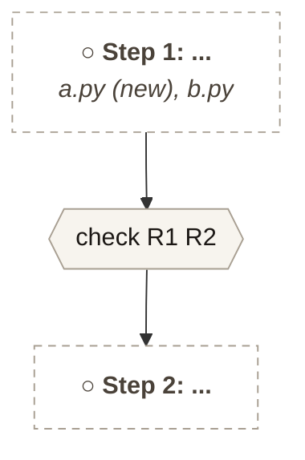
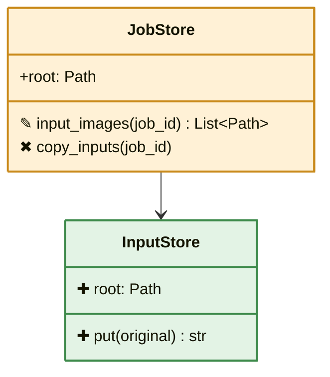

# Feature Development Workflow

Structured workflow that turns a feature request into a spec, tasks, implementation, and a reviewed handoff. All artifacts live under `specs/<NNN>-<feature-name>/`.

## Quick Reference

```
Feature idea
  |
  v
spec.md    -->  the PRD: objective, requirements + checks, plan flowchart, class diagram, file tables [Status: Draft]
  |
  v
tasks.md   -->  HOW to build it (design notes at top, ordered task checklist)     [Status: In Progress]
  |
  v
implement  -->  execute tasks phase-by-phase
  |
  v
/code-review --> REVIEW.md per docs/guides/CODE_REVIEW_CHECKLIST.md               [Status: Code Review]
  |               ^^^ MANDATORY GATE — no spec flips to Implemented without this
  v
hand off   -->  CHANGES_LOG.md entry; high-severity findings resolved or waived   [Status: Implemented]
```

## Branch & merge policy (locked)

`main` is protected. Nothing lands on `main` except through a Pull Request whose checks are green.

**One branch per effort, named for it:**

| Effort | Branch name | Gate to create |
|---|---|---|
| Feature (has a spec/PRD) | `spec/<NNN>-<slug>` | `specs/<NNN>-<name>/spec.md` exists (Draft counts) |
| Bug fix | `fix/<slug>` | a sighting filed in `docs/project/SIGHTINGS.md` |
| Housekeeping / docs | `chore/<slug>` | — |

**Rules:**
- **No direct pushes to `main`.** Branch → PR → merge. (Enforced by GitHub branch protection.)
- **Required check: `fast-tests` must be green** before a PR merges (the model-free CI suite).
- **PR body links the spec dir** (`specs/<NNN>-*/`) and stays scoped to one effort — no catch-all branches (the `specs/093-095-analysis-studios` sprawl is the anti-pattern this rule exists to prevent).
- **The Code Review gate still governs `Implemented`**: the PR that flips a spec to `Implemented` must include `REVIEW.md`; High-severity findings block the merge (see below).
- **Delete the branch after merge.** One live branch per active effort.

## Spec lifecycle (locked)

`Draft → In Progress → Code Review → Implemented`

No skipping `Code Review`. The `/code-review` slash command produces `specs/<NNN>-<name>/REVIEW.md` against `docs/guides/CODE_REVIEW_CHECKLIST.md`. Any High-severity finding blocks the move to `Implemented` until resolved or explicitly waived (waiver recorded in REVIEW.md).

**Why this gate exists**: SIGHTING-061 shipped a 100%-face-rejection regression in spec-033 because the architecture tests checked code shape, not whether the contracts were actually exercised on real data. The Code Review gate forces an explicit "what test would catch the failure modes this feature was supposed to prevent?" walk-through before handoff.

## Documentation update mandate

Any spec that changes a class, Pydantic model, Pandera schema, DB column, pipeline step, or boundary contract **must** update the corresponding HTML in `docs/architecture/` in the same PR:

| Changed | Update |
|---|---|
| DB column | `docs/architecture/db_schemas.html` |
| Class / Pydantic / Pandera / dataclass field | `docs/architecture/classes.html` |
| Pipeline step / bridge / exporter / read side | `docs/architecture/data_flow.html` |
| New architecture doc added | `docs/architecture/index.html` (the entry-point list) |

The Code Review gate (§7 of `docs/guides/CODE_REVIEW_CHECKLIST.md`) blocks handoff on stale docs.

## Required Artifacts (2 files)

### 1. `spec.md` — the PRD: what, how we know it works, and what the code will look like

**Owner rule (2026-10-23):** a PRD must be readable at a glance: diagrams over prose. Six sections, in
this order, nothing before them except the header. Diagrams are mermaid blocks (` ```mermaid `);
`scripts/md2html.py` renders them in the HTML view.

**Structure**:
````markdown
# spec-NNN — <Name>
**Status:** Draft · **Created:** YYYY-MM-DD · **Roadmap:** Stage X · **Resolves:** SIGHTING-NNN (if any)

<p class="legend">Colour = type of change: <span class="tag new">NEW</span> <span class="tag chg">CHANGED</span> <span class="tag del">REMOVED</span>. Progress = ● done · ◐ partly done · ○ planned. In the class diagram: ✚ new member · ✎ changed · ✖ removed · unmarked = unchanged.</p>

## 1. Objective
At most 3 lines: what changes for the user, and why now.

## 2. Requirements
10-15 rows at most. Each row is one requirement as we understand it, and the check that proves it.
| # | Status | Requirement | How we know it works |
|---|---|---|---|
| R1 | ○ planned | ... | named test file / real-data result / named Playwright test |

## 3. Plan
One flowchart: what we build, in what order, which modules each step touches, and the check that
closes each step (the same checks as §2).


## 4. Class diagram
The classes as they will look after the change: new ones, changed ones, and the existing classes they
talk to. Colour the class (green new, amber changed, grey existing) and mark each member: ✚ new, ✎ changed,
✖ removed, unmarked = unchanged. Put the marker *before* the member (after it, mermaid shows it as a return type).


## 5. New files   (all NEW; test files go in tasks.md, per task)
| File | Class | Responsibility | Methods | Attributes | Status |
|---|---|---|---|---|---|

## 6. Modified files   (all CHANGED; REMOVED files get their own rows with <span class="tag del">REMOVED</span>)
| File | Class / function | Today | After this spec | Req | Status |
|---|---|---|---|---|---|

## Open decisions / risks / non-goals   (optional, short bullets)
````

**Rules**:
- Objective: 3 lines maximum. Requirements: 15 rows maximum. If it needs more, the spec is two specs.
- Every requirement has a concrete check (test file, real-data result, or Playwright on the real app).
- **Colour means type of change only** (green NEW, amber CHANGED, grey EXISTING, red REMOVED), the same in
  tables and diagrams. **Progress never uses colour:** ● done, ◐ partly done, ○ planned (tables and plan nodes;
  done plan steps get a thick border, planned ones dashed).
- Modified files show the change as a **Today → After this spec** pair. Use `<mark>` only for a single changed
  word or value inside prose, never for whole cells.
- Mark class members in diagrams by what actually exists in the code today (✎ only for members that exist).
- The plan flowchart names the modules each step touches and ends each step on its check.
- The class diagram and the file tables are the design; `tasks.md` only orders the work.
- Mark unresolved questions as `[NEEDS CLARIFICATION]` and resolve them before code.
- Older specs keep their format; a spec gets the new format when it is next drafted or re-planned.
- **Write PRDs with the `/prd` skill** (`.claude/skills/prd/SKILL.md`): it grounds the design in the code, renders,
  and runs `scripts/prd_lint.py <spec.md> --render`, which must report 0 errors before the owner sees the spec.
  The lint enforces the limits above, named checks, plan coverage, file tables vs the disk, class-diagram members
  vs the code (AST), and that every diagram draws. Example: `specs/115-album-workbench/spec.md`.

### 2. `tasks.md` — Define HOW to build it

**Focus**: Design decisions, then ordered implementation tasks.

**Structure**:
```markdown
# Tasks: <Feature Name> (NNN)

## Design Notes
Brief technical decisions that inform the tasks below.
- **D1**: <decision and rationale>
- **D2**: <decision and rationale>

## Phase 1: <Name>
- [ ] T001 Description with file path `face_cluster/foo.py`
- [ ] T002 [P] Description (parallelizable)
- [ ] T003 Write tests for T001-T002 in `tests/face_clustering/test_foo.py`

**Checkpoint**: How to verify this phase works.

## Phase 2: <Name>
...
```

**Rules**:
- Design lives in spec.md (§3-§6: plan flowchart, class diagram, file tables); tasks.md orders the work and records short design notes
- Tasks include exact file paths
- `[P]` marks tasks that can run in parallel
- Each phase ends with a checkpoint (usually a test command)
- Mark tasks done as `[x]` during implementation

### 3. `updates.md` — Progress & verification log (required once work starts)
Dated entries, newest first. Each entry: what landed + **how it was verified** (test file and count,
report path, real-data outcome). Also records decisions, blockers, and branch-outs to other specs.
Header links back to `ROADMAP.md` and names the roadmap stage. Flipping to `Implemented` requires an
entry naming the verification evidence. Render with `scripts/md2html.py` after each edit.

## Optional Artifacts

Create these only when they earn their keep:

| File | When to create |
|------|---------------|
| `research.md` | Genuinely unresolved technical questions requiring investigation before you can write tasks |
| `data-model.md` | Complex schema changes touching 3+ modules (new DB tables, new CSV columns across writer/reader pairs) |
| `contracts/<name>.md` | Public API surface shared across packages (rare in this repo) |
| `checklists/<domain>.md` | Regulated domains, security-sensitive features |

**If you're unsure whether to create an optional file**: don't. Put the content in the Design Notes section of `tasks.md` instead.

## Exemptions (no spec required)

| Change type | What to do instead |
|-------------|-------------------|
| Bug fix | File sighting in `docs/SIGHTINGS.md`, fix, log learning |
| Isolated refactor (no behavior change) | Implement directly, update `CHANGES_LOG.md` |
| Doc-only change | Edit docs directly |

## Integration with Project Trackers

| Event | Tracker | Action |
|---|---|---|
| `spec.md` created | `docs/FEATURE_REQUESTS.md` | Add feature entry |
| `tasks.md` generated | `TODO.md` | Copy key tasks |
| Implementation complete | `CHANGES_LOG.md` | Append entry |
| Bug found during impl | `docs/SIGHTINGS.md` | File sighting |
| Lesson learned | `docs/LEARNINGS.md` | Append (<=5 lines) |
| Architecture changed | `docs/architecture.md` | Update |

## Directory Layout

```
specs/
  NNN-feature-name/
    spec.md          # Required: what to build
    tasks.md         # Required: how to build it
    research.md      # Optional: unresolved questions
    data-model.md    # Optional: complex schema changes
    contracts/       # Optional: shared API surfaces
    checklists/      # Optional: domain-specific quality gates

.specify/
  feature.json       # Active feature pointer (auto-managed)
```

## Legacy Specs

Specs 001–012 were created under the previous 7-file workflow. They remain valid — the extra files (`plan.md`, `research.md`, `data-model.md`, `contracts/`, `checklists/`) just aren't required for new specs going forward.
