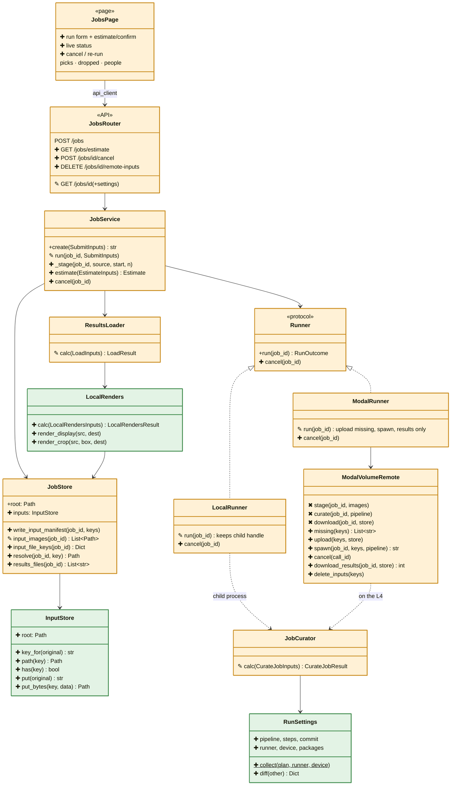

# spec-115 — Album workbench: run, re-run and examine albums, locally or on the L4

**Status:** In Progress (W1 done 2026-10-23) · **Created:** 2026-10-23 · **Roadmap:** Stage C, next, before Gate 1 · **Split from:** [spec-112](../112-live-db-storage-runner/spec.html) Phase A2

Colour = type of change: NEW CHANGED REMOVED. Progress = ● done · ◐ partly done · ○ planned. In the class diagram: ✚ new member · ✎ changed · ✖ removed · unmarked = unchanged.

## 1. Objective

Start, watch, cancel and re-run album jobs from the Albumify app, on this PC or the Modal L4, and examine
the results the same way either way. Photos go up once and never come back; re-runs reuse what was
already computed. Gate 1 (judging the picks) is done in this app.

## 2. Requirements

| # | Status | Requirement | How we know it works |
|---|---|---|---|
| R1 | ○ | Start a job from the Jobs page: folder, photo range, runner (local / L4 / Modal CPU), pipeline name | `tests/test_jobs_page_run_e2e.py::test_run_from_form` (local `minimal` job ends `succeeded`, its album opens); real L4 run of Slovakia26 from the form |
| R2 | ○ | L4 jobs show an estimate (photos to upload, GPU minutes, cost) and need a confirm. **Spend cap:** a job over `max_photos_l4` (default 1,000) or `max_gpu_minutes` (default 30, about $0.40 on the L4) is refused | `tests/control/test_job_service.py::ut_Estimate` (estimate, both limits → 422); `test_jobs_page_run_e2e.py::test_l4_needs_confirm` |
| R3 | ○ | Status updates without a manual refresh: stage, latest event, elapsed time | `test_jobs_page_run_e2e.py::test_status_updates_without_reload` (status reaches `succeeded`, no page reload) |
| R4 | ○ | Cancel, local or L4, within 30 s. **End state:** job `failed`, error "cancelled by owner"; its results are not loaded and any partial `results/` is deleted; staged photos stay (they are shared); the L4 queue slot is freed at once; cache rows already written stay (they are valid), an L4 job's uncommitted cache writes are lost | `tests/control/test_job_service.py::ut_Cancel` (fake runners: end state, queue freed); real cancel on both runners |
| R5 | ○ | Re-run refills the form from a finished job; when the new job finishes, Compare runs opens on the pair | `test_jobs_page_run_e2e.py::test_rerun_opens_compare` |
| R6 | ◐ local | **Guarantees:** each photo is resized and stored once, by content; job runs use the feature cache, so a re-run recomputes no cached step; a cached result from another model version is never reused | ● `tests/serving/test_input_store.py`, `test_job_service.py`, `tests/pipeline/test_cache_model_version.py`; ● real pair: 0 new photos, IQA 1017→26 ms, scene embedding 7719→10 ms, same picks; ○ L4 side in R9 |
| R7 | ◐ | **File serving is per job:** a job's image routes serve only that job's own files and the photos in its manifest; another job's photo, a path outside the store, or a made-up key → 404 | ● `tests/serving/test_input_store.py::..._resolve_stays_inside`; ○ `tests/api/test_jobs_router.py::test_other_jobs_photo_is_404` |
| R8 | ○ | No picture comes back from Modal: copy-back is at most 10 files and under 1 min for Slovakia26 (was 993 files, 19.4 min) | real L4 run: file count + time in the job events |
| R9 | ○ | An L4 re-run uploads 0 photos and is served by the cache on a Modal Volume | real L4 re-run: `0 new` in staging, cache hits in the worker log, GPU time well below the first run |
| R10 | ○ | Display images and face crops are made on the PC from its own copies + the face boxes; local and L4 jobs leave the same files. **Orientation gate (T2.1):** PC crops overlap the worker's crops (IoU ≥ 0.5) on ≥ 19 of 20 real faces, else the worker keeps sending crops | T2.1 check on `slovakia26` (report on disk); `tests/control/test_local_renders.py` (same file set local vs fake-Modal; crop inside its box) |
| R11 | ○ | Local and L4 runs of the same photos give the same picks | real 48-photo slice run locally and on the L4 → Compare runs: 0 moved picks |
| R12 | ○ | Every run records its settings (pipeline steps + parameters, code commit, runner, device, key library versions); Compare runs shows what differs | `tests/serving/test_run_settings.py`; `test_jobs_page_run_e2e.py::test_compare_shows_settings_diff` |
| R13 | ○ | Photos on Modal unused for 7 days are deleted, including the per-job photo copies left on `albumify-jobs` by earlier runs; a button deletes a job's photos now | `tests/serving/test_modal_staging.py` (fake Volume: purge, shared photos kept); real button, then a Volume listing |
| R14 | ◐ inputs | Older jobs (images in `input/`, display/crops from the worker) still open and show | ● `tests/serving/test_curate_job.py::..._older_job_...`; ○ `test_local_renders.py::test_old_job_files_untouched` |

**Definition of done:** every row ● with its evidence in [updates.md](updates.html); full suite green; `/code-review` → REVIEW.md with no high findings; `scripts/prd_lint.py` passes.

## 3. Plan

Thick border ● = done; dashed ○ = planned. Each step ends on the check that closes it.

```mermaid
flowchart TD
  W1["<b>● W1 Stable inputs + cache</b> (done)<br/><i>input_store.py (new), job_store.py, job_service.py,<br/>curate_job.py, discover_images.py, loader.py, routers/jobs.py</i>"]
  C1{{"● checked R6 R7 R14 (part)<br/>21 tests · real 12-photo pair · full suite 1,627 passed"}}
  W2["<b>○ W2 Results-only, renders on the PC</b><br/>worker stops writing display/ and faces/;<br/>LocalRenders makes them from inputs + boxes ·<br/>file routes serve only the job's own files<br/><i>local_renders.py (new), curate_job.py, loader.py, job_store.py</i>"]
  C2{{"check R7 R10 R14<br/>orientation gate ≥ 19/20 · same files local vs fake-Modal · crop inside its box"}}
  W3["<b>○ W3 Modal: inputs + cache Volumes, retention</b><br/>upload only missing photos · cache on a Volume ·<br/>results-only download · 7-day purge + delete button<br/><i>modal_app.py, runners.py, curate_job.py, routers/jobs.py</i>"]
  C3{{"check R8 R9 R13 with a fake Volume<br/>2nd stage uploads 0 · download lists results only"}}
  W4["<b>○ W4 The app</b><br/>run form + estimate/confirm · live status · Cancel · Re-run ·<br/>run settings + Compare diff<br/><i>run_settings.py (new), pages/jobs.py, pages/compare.py,<br/>api_client.py, routers/jobs.py, job_service.py, runners.py</i>"]
  C4{{"check R1-R5 R12<br/>Playwright on the real app, local minimal jobs"}}
  W5["<b>○ W5 Prove on real data</b><br/>owner OK before each L4 run<br/>Slovakia26 on the L4 from the form, then the re-run ·<br/>local vs L4 on 48 photos · cancel on both runners"]
  C5{{"check R1 R4 R8 R9 R11 R13<br/>updates.md evidence · full suite · /code-review"}}
  W1 --> C1 --> W2 --> C2 --> W3 --> C3 --> W4 --> C4 --> W5 --> C5
  classDef done fill:#FFFFFF,stroke:#1B1714,stroke-width:3px,color:#1B1714
  classDef todo fill:#FFFFFF,stroke:#A89F92,stroke-width:1px,stroke-dasharray:5 4,color:#4A4239
  classDef check fill:#F7F4EE,stroke:#A89F92,color:#1B1714
  class W1,C1 done
  class W2,W3,W4,W5 todo
  class C2,C3,C4,C5 check
```

## 4. Class diagram

Green = new class, amber = changed class. ✚ new member · ✎ changed · ✖ removed · unmarked = unchanged.

## 5. New files

All NEW. Test files are listed per task in [tasks.md](tasks.html).

| File | Class | Responsibility | Methods | Attributes | Status |
|---|---|---|---|---|---|
| `sim_bench/serving/input_store.py` | `InputStore` | Content-addressed staged photos `<sha16>/<name>.jpg`, written once | `key_for`, `path`, `has`, `put`, `put_bytes` | `root`; module `STAGING_VERSION` | ● |
| `sim_bench/control/local_renders.py` | `LocalRenders` (+ `Inputs`, `Result`) | Make `display/` (picks) and `faces/<id>.jpg` (box + margin) from the job's own inputs and `results/bundle.json`; same for every runner | `calc`, `render_display`, `render_crop` | `margin`, `crop_size` | ○ W2 |
| `sim_bench/serving/run_settings.py` | `RunSettings` (dataclass) | What a run ran with: pipeline, resolved steps + parameters, code commit, runner, device, key library versions | `collect` (classmethod), `to_dict`, `diff` | `pipeline`, `steps`, `commit`, `runner`, `device`, `packages` | ○ W4 |

## 6. Modified files

All CHANGED.

| File | Class / function | Today | After this spec | Req | Status |
|---|---|---|---|---|---|
| `sim_bench/serving/job_store.py` | `JobStore` | job's photos copied into `input/` | `input/manifest.json` → shared store; `resolve()`; W2: `results_files()` | R6 R7 R10 | ● W1 · ○ W2 |
| `sim_bench/serving/job_service.py` | `JobService` | stages copies; no estimate, no cancel | stages via the store (only new photos resized); W4: `estimate`, `cancel`, one L4 job at a time, photo limit | R2 R4 R6 | ● W1 · ○ W4 |
| `sim_bench/serving/curate_job.py` | `JobCurator`, `run_pipeline` | temp copy of inputs; **no feature cache**; writes display/ + crops | explicit paths + cache attached; W2: no display/ or crops; W4: `RunSettings` in run.json | R6 R8 R12 | ● W1 · ○ W2 · ○ W4 |
| `sim_bench/serving/runners.py` | `Runner`, `LocalRunner`, `ModalRunner`, `ModalVolumeRemote` | uploads all photos each run; downloads 993 files one by one; no cancel | upload only missing photos; `spawn` (cancellable); download results only; `cancel`; `delete_inputs` | R4 R8 R9 R13 | ○ W3 · W4 |
| `sim_bench/serving/modal_app.py` | `curate_job`, `purge_inputs` (new) | photos per job on `albumify-jobs`, kept forever; cache lost at exit | `albumify-inputs` + `albumify-cache` Volumes; cache committed after each job; daily purge of photos unused 7 days | R9 R13 | ○ W3 |
| `sim_bench/control/loader.py` | `ResultsLoader` | reads `input/` names; display/crops from the worker | input keys from the manifest; W2: runs `LocalRenders` first | R10 R14 | ● W1 · ○ W2 |
| `sim_bench/api/routers/jobs.py`, `sim_bench/api/schemas/jobs.py` | routes, `JobDetail` | files only from the job folder | files via `resolve`, limited to the job's own files (R7); W4: `/jobs/estimate`, `/jobs/{id}/cancel`, `DELETE /jobs/{id}/remote-inputs`, `settings` | R2 R4 R7 R12 R13 | ● W1 · ○ W4 |
| `sim_bench/pipeline/steps/discover_images.py` | `DiscoverImagesStep` | always scans a folder | uses given image paths when handed them | R6 | ● |
| `app/streamlit/pages/jobs.py` | page functions | view only; "Refresh to update" | run form + estimate/confirm, live status, Cancel, Re-run | R1-R5 | ○ W4 |
| `app/streamlit/pages/compare.py` | page functions | picks and people only | "Settings that differ" section | R12 | ○ W4 |
| `app/streamlit/api_client.py` | `ApiClient` | no job submit | `submit_job`, `estimate_job`, `cancel_job`, `delete_remote_inputs` | R1-R4 R13 | ○ W4 |
| `configs/serving.yaml` | | runner, pipeline, device | `max_photos_l4`, `l4_seconds_per_photo` | R2 | ○ W4 |
| `docs/architecture/{classes,data_flow}.html` | | | new classes; the job data flow | doc rule | ● W1 · ○ close-out |

## Open decisions / risks / non-goals

- **Decided (owner, 2026-10-23):** photos kept on Modal 7 days after last use; re-run chooses the pipeline by name only.
- **Risk: crop orientation.** Face boxes come from the worker's detector; the PC crop must read the photo the same way
  (EXIF orientation, rotated-face detection). Gate in R10: checked on a real job before the worker stops sending crops.
- **Risk: one cache writer.** A SQLite cache on a Modal Volume is safe for one job at a time, so L4 jobs queue.
- **Risk: steps without a model version** in their cache key rely on a `model_name` bump when their output changes;
  a cache that persists on the L4 makes forgetting that costlier.
- **Non-goals:** moving old Modal job outputs (album files stay on `albumify-jobs` until spec-112 Phase B), jobs surviving an API restart, cloud DB/storage (spec-112 Phase B), user accounts, the public site.
