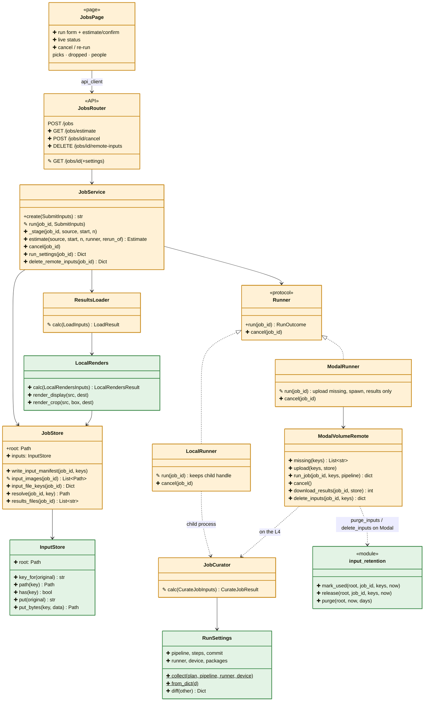

# spec-115 — Album workbench: run, re-run and examine albums, locally or on the L4

**Status:** Implemented 2026-10-23 (W1-W5 done; review ACCEPT after fixes) · **Created:** 2026-10-23 · **Roadmap:** Stage C, next, before Gate 1 · **Split from:** [spec-112](../112-live-db-storage-runner/spec.html) Phase A2

Colour = type of change: NEW CHANGED REMOVED. Progress = ● done · ◐ partly done · ○ planned. In the class diagram: ✚ new member · ✎ changed · ✖ removed · unmarked = unchanged.

## 1. Objective

Start, watch, cancel and re-run album jobs from the Albumify app, on this PC or the Modal L4, and examine
the results the same way either way. Photos go up once and never come back; re-runs reuse what was
already computed. Gate 1 (judging the picks) is done in this app.

## 2. Requirements

| # | Status | Requirement | How we know it works |
|---|---|---|---|
| R1 | ● | Start a job from the Jobs page: folder, photo range, runner (local / L4 / Modal CPU), pipeline name | ● `tests/test_jobs_page_run_e2e.py::test_run_from_form...`; ● real: Slovakia26 (715) on the L4 started from the form, succeeded in 10.7 min |
| R2 | ● | L4 jobs show an estimate (photos, GPU minutes, cost) and need a confirm; how many photos were actually uploaded is logged when the job runs. **Spend cap:** a job over `max_photos_l4` (default 1,000) or `max_gpu_minutes` (default 30, about $0.40 on the L4) is refused | ● `tests/control/test_job_service.py::ut_Estimate` (estimate, both limits, every L4 path); ● `test_jobs_page_run_e2e.py::test_l4_needs_confirm`; ● real: 715 photos → 9.7 GPU-min, $0.13, confirm shown |
| R3 | ● | Status updates without a manual refresh: stage, latest event, elapsed time | ● `test_jobs_page_run_e2e.py::test_run_from_form_status_updates_without_reload...` (status to album, no reload) |
| R4 | ● | Cancel, local or L4, within 30 s. **End state:** job `failed`, error "cancelled by owner"; its results are not loaded and any partial `results/` is deleted; staged photos stay (they are shared); the L4 queue slot is freed at once; cache rows already written stay (they are valid), an L4 job's uncommitted cache writes are lost | ● `tests/control/test_job_service.py::ut_Cancel`, `ut_ReviewFixes` (waiting job, before child starts, loading refused); ● `test_jobs_page_run_e2e.py::test_cancel_a_running_job`; ● real L4 cancel: 5.2 s, no results kept |
| R5 | ● | Re-run refills the form from a finished job; when the new job finishes, Compare runs opens on the pair | ● `test_jobs_page_run_e2e.py::test_rerun_opens_compare`; ● real: two L4 re-runs opened Compare runs on their pair |
| R6 | ● | **Guarantees:** each photo is resized and stored once, by content; job runs use the feature cache, so a re-run recomputes no cached step; a cached result from another model version is never reused | ● `tests/serving/test_input_store.py`, `test_job_service.py`, `tests/pipeline/test_cache_model_version.py`; ● real: local pair IQA 1017→26 ms; L4 re-run 0 new photos (R9) |
| R7 | ● | **File serving is per job:** a job's image routes serve only that job's own files and the photos in its manifest; another job's photo, a path outside the store, or a made-up key → 404 | ● `tests/serving/test_input_store.py::..._resolve_stays_inside`, `tests/api/test_jobs_router.py::test_other_jobs_photo_is_404` |
| R8 | ● | No picture comes back from Modal: copy-back is at most 10 files and under 1 min for Slovakia26 (was 993 files, 19.4 min) | ● real L4 run: 5 result files copied back (was 993); 0 pictures; `tests/serving/test_modal_staging.py::test_only_results_come_back` |
| R9 | ● | An L4 re-run uploads 0 photos and is served by the cache on a Modal Volume | ● real L4 re-run: `uploaded 0 new photos (715 already there)`, pipeline 437 s → 46 s, start to album 1 min 51 s |
| R10 | ● | Display images and face crops are made on the PC from its own copies + the face boxes; local and L4 jobs leave the same files. **Orientation gate (T2.1):** on 20 real faces (5 per camera rotation) the PC crop is the worker's face, rotation proven by a no-rotate control; **accepted by the owner 2026-10-23** (ArcFace 18/20 ≥ 0.3: misses were a tilted head and an 11 px face) | ● T2.1 `reports/2026-10-23_spec115_crop_orientation/report.html`; ● `tests/control/test_local_renders.py` (7), `test_job_service.py::..._leave_the_same_files`; ● real L4 job: 251 displays + 987 crops rendered on the PC, People tab 410/410 crops load |
| R11 | ● | Local and L4 runs of the same photos give the same picks | ● real 48-photo slice, local vs L4 → Compare runs: 18 same, 1 swapped, 0 missing, 0 extra (close enough) |
| R12 | ● | Every run records its settings (pipeline steps + parameters, code commit, runner, device, key library versions); Compare runs shows what differs | ● `tests/serving/test_run_settings.py`; ● real: Compare runs local vs L4 lists runner, device, torch/onnxruntime versions, step devices |
| R13 | ● | Photos on Modal unused for 7 days are deleted, including the per-job photo copies left on `albumify-jobs` by earlier runs; a button deletes a job's photos now | ● `tests/serving/test_modal_staging.py::ut_InputRetention`; ● real: button deleted the job's 6 photos from `albumify-inputs` (721 → 715); purge deployed (daily) |
| R14 | ● | Older jobs (images in `input/`, display/crops from the worker) still open and show | ● `tests/serving/test_curate_job.py::..._older_job_...`, `test_local_renders.py::test_existing_files_of_an_older_job_are_kept` |

**Definition of done:** every row ● with its evidence in [updates.md](updates.html); full suite green; `/code-review` → REVIEW.md with no high findings; `scripts/prd_lint.py` passes.

## 3. Plan

Thick border ● = done; dashed ○ = planned. Each step ends on the check that closes it.

```mermaid
flowchart TD
  W1["<b>● W1 Stable inputs + cache</b> (done)<br/><i>input_store.py (new), job_store.py, job_service.py,<br/>curate_job.py, discover_images.py, loader.py, routers/jobs.py</i>"]
  C1{{"● checked R6 R7 R14 (part)<br/>21 tests · real 12-photo pair · full suite 1,627 passed"}}
  W2["<b>● W2 Results-only, renders on the PC</b> (done)<br/>worker stops writing display/ and faces/;<br/>LocalRenders makes them from inputs + boxes ·<br/>file routes serve only the job's own files<br/><i>local_renders.py (new), curate_job.py, loader.py, job_store.py</i>"]
  C2{{"● checked R7 R10 (part) R14<br/>gate accepted · 6 render tests · same files local vs fake-Modal · real slovakia26 render"}}
  W3["<b>● W3 Modal: inputs + cache Volumes, retention</b> (done)<br/>upload only missing photos · cache on a Volume ·<br/>results-only download · 7-day purge + delete button<br/><i>modal_app.py, runners.py, curate_job.py, routers/jobs.py</i>"]
  C3{{"● checked R8 R9 R13 with a fake Volume<br/>2nd stage uploads 0 · download lists results only"}}
  W4["<b>● W4 The app</b> (done)<br/>run form + estimate/confirm · live status · Cancel · Re-run ·<br/>run settings + Compare diff<br/><i>run_settings.py (new), pages/jobs.py, pages/compare.py,<br/>api_client.py, routers/jobs.py, job_service.py, runners.py</i>"]
  C4{{"● checked R1-R5 R12<br/>Playwright on the real app, local minimal jobs"}}
  W5["<b>● W5 Prove on real data</b> (done)<br/>owner OK before each L4 run<br/>Slovakia26 on the L4 from the form, then the re-run ·<br/>local vs L4 on 48 photos · cancel on both runners"]
  C5{{"● checked R1 R4 R8 R9 R11 R13<br/>updates.md evidence · full suite · /code-review"}}
  W1 --> C1 --> W2 --> C2 --> W3 --> C3 --> W4 --> C4 --> W5 --> C5
  classDef done fill:#FFFFFF,stroke:#1B1714,stroke-width:3px,color:#1B1714
  classDef todo fill:#FFFFFF,stroke:#A89F92,stroke-width:1px,stroke-dasharray:5 4,color:#4A4239
  classDef check fill:#F7F4EE,stroke:#A89F92,color:#1B1714
  class W1,C1,W2,C2,W3,C3,W4,C4,W5,C5 done
```

## 4. Class diagram

Green = new class, amber = changed class. ✚ new member · ✎ changed · ✖ removed · unmarked = unchanged.

## 5. New files

All NEW. Test files are listed per task in [tasks.md](tasks.html).

| File | Class | Responsibility | Methods | Attributes | Status |
|---|---|---|---|---|---|
| `sim_bench/serving/input_store.py` | `InputStore` | Content-addressed staged photos `<sha16>/<name>.jpg`, written once | `key_for`, `path`, `has`, `put`, `put_bytes` | `root`; module `STAGING_VERSION` | ● |
| `sim_bench/control/local_renders.py` | `LocalRenders` (+ `Inputs`, `Result`) | Make `display/` (picks) and `faces/<id>.jpg` (box + margin) from the job's own inputs and `results/bundle.json`; same for every runner | `calc`, `render_display`, `render_crop` | `margin`, `crop_size` | ● |
| `sim_bench/serving/input_retention.py` | module functions | Which photos on a worker's input store may go: per-photo `.used.json` claims (written atomically; missing or damaged → folder time), 7-day window, legacy per-job copies | `mark_used`, `release`, `purge` | `RETENTION_DAYS` = 7 | ● |
| `sim_bench/serving/run_settings.py` | `RunSettings` (dataclass) | What a run ran with: pipeline, resolved steps + parameters, code commit, runner, device, key library versions | `collect`, `from_dict` (classmethods), `to_dict`, `diff` | `pipeline`, `steps`, `commit`, `runner`, `device`, `packages` | ● |

## 6. Modified files

All CHANGED.

| File | Class / function | Today | After this spec | Req | Status |
|---|---|---|---|---|---|
| `sim_bench/serving/job_store.py` | `JobStore` | job's photos copied into `input/` | `input/manifest.json` → shared store; `resolve()`; `results_files()`; `resolve` per job (R7) | R6 R7 R10 | ● |
| `sim_bench/serving/job_service.py` | `JobService` | stages copies; no estimate, no cancel | stages via the store (only new photos resized); `estimate` + spend cap on every L4 path; `cancel` (queued, waiting its turn, running); one Modal job at a time; re-run by job; `run_settings`; `delete_remote_inputs` | R2 R4 R6 | ● |
| `sim_bench/serving/curate_job.py` | `JobCurator`, `run_pipeline` | temp copy of inputs; **no feature cache**; writes display/ + crops | explicit paths + cache attached; W2: no display/ or crops; W4: `RunSettings` in run.json | R6 R8 R12 | ● |
| `sim_bench/serving/runners.py` | `Runner`, `LocalRunner`, `ModalRunner`, `ModalVolumeRemote` | uploads all photos each run; downloads 993 files one by one; no cancel | upload only missing photos (with a used-claim); `run_job` spawns a cancellable call; results-only download, written atomically; `cancel` on both runners; `delete_inputs` | R4 R8 R9 R13 | ● |
| `sim_bench/serving/modal_app.py` | `curate_job`, `purge_inputs` (new) | photos per job on `albumify-jobs`, kept forever; cache lost at exit | `albumify-inputs` + `albumify-cache` Volumes; cache copied in/out of the Volume per job and committed; `delete_inputs`; daily purge of photos unused 7 days | R9 R13 | ● (cpu app deployed) |
| `sim_bench/control/loader.py` | `ResultsLoader` | reads `input/` names; display/crops from the worker | input keys from the manifest; W2: runs `LocalRenders` first | R10 R14 | ● |
| `sim_bench/api/routers/jobs.py`, `sim_bench/api/schemas/jobs.py` | routes, `JobDetail` | files only from the job folder | files via `resolve`, limited to the job's own files (R7); W4: `/jobs/estimate`, `/jobs/{id}/cancel`, `DELETE /jobs/{id}/remote-inputs`, `settings` | R2 R4 R7 R12 R13 | ● |
| `sim_bench/pipeline/steps/face_cluster_export.py` | `_crop_from_aligned` | flipped RGB it took for BGR: every crop red/blue swapped (SIGHTING-141) | keeps RGB; tested through the real align chain | R10 | ● |
| `sim_bench/pipeline/steps/discover_images.py` | `DiscoverImagesStep` | always scans a folder | uses given image paths when handed them | R6 | ● |
| `app/streamlit/pages/jobs.py` | page functions | view only; "Refresh to update" | run form + estimate/confirm, live status, Cancel, Re-run | R1-R5 | ● |
| `app/streamlit/pages/compare.py` | page functions | picks and people only | "Settings that differ" section | R12 | ● |
| `app/streamlit/api_client.py` | `ApiClient` | no job submit | `submit_job`, `estimate_job`, `cancel_job`, `delete_remote_inputs` | R1-R4 R13 | ● |
| `configs/serving.yaml`, `sim_bench/serving/serving_config.py` | `ServingConfig` | runner, pipeline, device | `max_photos_l4` 1000, `max_gpu_minutes` 30, `l4_fixed_seconds`, `l4_seconds_per_photo`, `l4_dollars_per_hour` | R2 | ● |
| `docs/architecture/{classes,data_flow}.html` | | | new classes; the job data flow | doc rule | ● |

## Open decisions / risks / non-goals

- **Decided (owner, 2026-10-23):** photos kept on Modal 7 days after last use; re-run chooses the pipeline by name only.
- **Risk: crop orientation.** Face boxes come from the worker's detector; the PC crop must read the photo the same way
  (EXIF orientation, rotated-face detection). Gate in R10: checked on a real job before the worker stops sending crops.
- **Risk: one cache writer.** The worker copies the cache from its Volume, runs, and copies it back, so two overlapping Modal jobs would lose one's rows. The API runs one Modal job at a time (GPU and CPU); the gate is per API process, so a second API or the legacy driver script (`scripts/modal_curate_driver.py`, which also bypasses the shared store; its staged copies are purged after 7 days) must not run alongside.
- **Risk: steps without a model version** in their cache key rely on a `model_name` bump when their output changes;
  a cache that persists on the L4 makes forgetting that costlier.
- **Risk: owner-only API.** `GET /jobs/estimate` and `POST /jobs` take any folder on the server; fine for this single-owner setup, must change before anything is public (spec-106 upload path).
- **Non-goals:** moving old Modal job outputs (album files stay on `albumify-jobs` until spec-112 Phase B), jobs surviving an API restart, cloud DB/storage (spec-112 Phase B), user accounts, the public site.
