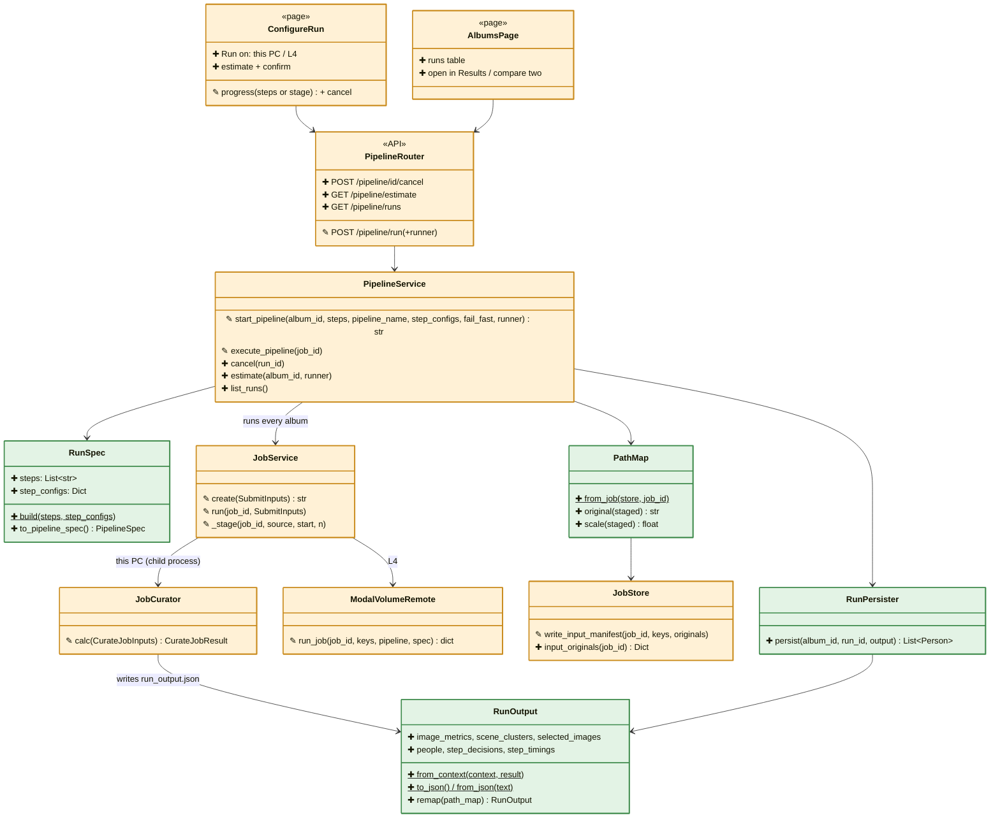

# spec-116 — One run path: choose this PC or the L4, see the album in Albums either way

**Status:** In Progress · **Created:** 2026-10-25 · **Roadmap:** Stage C, before Gate 1 · **Follows:** [spec-115](../115-album-workbench/spec.html)

Colour = type of change: NEW CHANGED REMOVED. Progress = ● done · ◐ partly done · ○ planned. In the class diagram: ✚ new member · ✎ changed · ✖ removed · unmarked = unchanged.

## 1. Objective

There is one way to run an album: Configure & Run, where you choose **this PC** or the **L4** before the run starts.
Whichever machine runs it, the run shows up in Albums, Results, People and Explore with the same "why" detail.
Re-runs reuse that machine's feature cache. Today an L4 run can be seen only on the Jobs page, with no reasons.

## 2. Requirements

| # | Status | Requirement | How we know it works |
|---|---|---|---|
| R1 | ● | Configure & Run has **Run on: this PC / L4 (GPU)**. The L4 shows the spec-115 estimate, needs a confirm, and the spend cap applies | ● `tests/test_configure_run_on_e2e.py::test_l4_needs_confirm`; ● `tests/api/test_pipeline_router.py::test_l4_over_cap_is_refused` |
| R2 | ● | **One spec:** the same steps and parameters (profile + page overrides + the `people_clustering` block) reach either machine. The job path stops ignoring `people_clustering` | ● `tests/pipeline/test_run_spec.py::test_same_spec_for_both_machines`, `::test_people_clustering_reaches_the_steps` |
| R3 | ● | Both machines analyse the same inputs: the 768 px copies, staged once by content (spec-115 `InputStore`) | ● `tests/serving/test_run_output.py::test_local_run_reads_staged_copies` |
| R4 | ● | Every run returns one `results/run_output.json`: image metrics, scenes, picks, people, decisions, timings (no pictures). One `RunPersister` writes the regular tables from it, whichever machine ran it | ● `tests/serving/test_run_output.py::test_round_trip_writes_the_same_rows` (in-process vs read back from JSON) |
| R5 | ◐ | Stored paths point at the **original photos**; pixel boxes are scaled to the original's size; [0,1] boxes stay as they are | ● `tests/serving/test_path_map.py`; ○ real: L4 run's People crops cut the right face |
| R6 | ◐ | Results, People & Faces and Explore show an L4 run the same way as a local one, including the per-photo reasons | ● `tests/test_configure_run_on_e2e.py::test_l4_run_opens_in_results` (Modal faked); ○ real: Slovakia26 on the L4, all pages, all images load |
| R7 | ● | Progress while running. This PC: the step list, as today. L4: the stage (uploading, running, copying back) and elapsed time. **Cancel** works on both | ● `tests/test_configure_run_on_e2e.py::test_progress_and_cancel` |
| R8 | ● | **Failure end states:** a step error, a cancel, or an unreachable Modal mark the run failed with the message shown on Configure & Run, and write no partial result rows | ● `tests/api/test_pipeline_service_runners.py::ut_FailureStates` |
| R9 | ◐ | A re-run reuses the cache of the machine it runs on (PC: `sim_bench.db`; L4: the Volume) | ○ real: Slovakia26 L4 re-run uploads 0 photos, pipeline ≤ ⅓ of the first run; ● real: PC re-run of 48 photos ≤ ⅓ (0.025) |
| R10 | ● | **Albums is one table of runs:** album, folder, ran on, date, photos, picks, people, status. A row opens Results on that run; ticking two opens Compare runs | ● `tests/test_albums_table_e2e.py::test_row_opens_results`, `::test_two_rows_open_compare` |
| R11 | ● | Every run is also a job under the same id, so Compare runs and the run settings work for it | ● `tests/api/test_pipeline_service_runners.py::test_run_is_a_job` |
| R12 | ● | Runs made before this spec (full-size originals, e.g. Budapest run15) still open unchanged | ● `tests/test_navigation_e2e.py` (7) green; ● real: Budapest run15 opens on every page |
| R13 | ◐ | The 768 px copies pick close enough to the full-size originals | ◐ real: Budapest (122) full-size vs 768 measured: Compare runs says NOT close enough, report data in `reports/2026-10-30_spec116_r13_fullsize_vs_768/` |
| R14 | ● | Explore's face-distance tab works for a run from either machine; it reads the run's own embeddings | ● `tests/api/test_results_face_distance.py::test_reads_run_embeddings` |
| R15 | ● | The Jobs page loses its run form and keeps job history and "Photos on Modal". Each job links to its run in Albums | ● `tests/test_jobs_page_run_e2e.py` updated |

**Definition of done:** every row ● with evidence in [updates.md](updates.html); full suite green; `/code-review` → REVIEW.md with no high findings; `scripts/prd_lint.py` passes. L4 runs only after the owner OKs the spend.

## 3. Plan

Thick border ● = done; dashed ○ = planned. Each step ends on the check that closes it.

```mermaid
flowchart TD
  W1["<b>● W1 One spec, one output, one writer</b><br/>build the spec once (incl. people_clustering) ·<br/>RunOutput from the context · RunPersister writes the tables<br/><i>run_spec.py (new), run_output.py (new), run_persister.py (new),<br/>pipeline_service.py, curate_job.py</i>"]
  C1{{"check R2 R4 R12<br/>same rows before/after · old runs open"}}
  W2["<b>● W2 Regular runs go through the job service</b><br/>stage copies → this PC or the L4 → run_output.json →<br/>originals' paths → RunPersister + job loader<br/><i>path_map.py (new), job_store.py, job_service.py, runners.py,<br/>modal_app.py, pipeline_service.py, routers/pipeline.py, routers/results.py</i>"]
  C2{{"check R3 R5 R8 R11 R14<br/>fake Modal · cancel · failure tests"}}
  W3["<b>● W3 The app</b><br/>Run on + estimate/confirm · progress/cancel ·<br/>Albums table · Jobs form removed<br/><i>pipeline_runner.py, configure.py, albums.py, jobs.py, api_client.py</i>"]
  C3{{"check R1 R6 R7 R10 R15<br/>Playwright on the real app"}}
  W4["<b>◐ W4 Prove on real data</b><br/>Budapest full-size vs 768 on this PC ·<br/>Slovakia26 on the L4 + re-run (owner OK first)"]
  C4{{"check R9 R13 + R5 R6 real<br/>updates.md evidence · full suite · /code-review"}}
  W1 --> C1 --> W2 --> C2 --> W3 --> C3 --> W4 --> C4
  classDef done fill:#FFFFFF,stroke:#1B1714,stroke-width:3px,color:#1B1714
  classDef todo fill:#FFFFFF,stroke:#A89F92,stroke-width:1px,stroke-dasharray:5 4,color:#4A4239
  classDef check fill:#F7F4EE,stroke:#A89F92,color:#1B1714
  class W1,W2,W3 done
  class W4 todo
  class C1,C2,C3,C4 check
```

## 4. Class diagram

Green = new class, amber = changed class, grey = existing context. ✚ new member · ✎ changed · ✖ removed · unmarked = unchanged.

## 5. New files

| File | Class | Responsibility | Methods | Attributes | Status |
|---|---|---|---|---|---|
| `sim_bench/pipeline/run_spec.py` | `RunSpec` | The steps + parameters of a run, built once; includes spreading `people_clustering` to the clustering steps | `build` (classmethod), `to_pipeline_spec`, `to_dict`, `from_dict` | `steps`, `step_configs` | ● |
| `sim_bench/serving/run_output.py` | `RunOutput` | Everything the regular pages need from a finished run, as plain JSON (moved out of `PipelineService`) | `from_context` (classmethod), `to_json`, `from_json`, `remap` | `image_metrics`, `scene_clusters`, `face_subclusters`, `selected_images`, `people`, `step_decisions`, `step_timings`, `siamese_comparisons`, `total_duration_ms` | ● |
| `sim_bench/api/services/run_persister.py` | `RunPersister` | Writes `pipeline_results`, `people`, `image_metric_rows`, `face_metric_rows` from a `RunOutput` | `persist` | `session` | ● |
| `sim_bench/serving/path_map.py` | `PathMap` | Staged copy → original photo path, and the pixel scale between them | `from_job` (classmethod), `original`, `scale` | `originals`, `scales` | ● |
| `sim_bench/api/services/run_embeddings.py` | `RunEmbeddings` | A run's own face embeddings, read before the cache (added in W2: the spec named only face-distance; People & Faces needs them too) | `has`, `get` | `jobs root` | ● |

## 6. Modified files

| File | Class / function | Today | After this spec | Req | Status |
|---|---|---|---|---|---|
| `sim_bench/api/services/pipeline_service.py` | `PipelineService` | runs the pipeline in the API process on the originals; builds and writes the result itself | builds a `RunSpec`, hands the run to `JobService` (this PC or L4), then `PathMap` + `RunPersister` | R2 R4 R8 R11 | ● |
| `sim_bench/serving/curate_job.py` | `JobCurator`, `CurateJobInputs` | steps from `configs/pipeline.yaml`, no `people_clustering`; writes album + bundle | runs the given `RunSpec`; also writes `results/run_output.json` and `progress.json` | R2 R4 R7 | ● |
| `sim_bench/serving/job_service.py` | `JobService`, `SubmitInputs` | jobs from the Jobs page only | also takes a `RunSpec` and an album run id; records each photo's original path | R3 R11 | ● |
| `sim_bench/serving/job_store.py` | `JobStore` | manifest = staged keys | manifest also maps key → original path | R5 | ● |
| `sim_bench/serving/runners.py`, `sim_bench/serving/modal_app.py` | `ModalVolumeRemote`, `_curate_job` | worker gets a pipeline name | worker gets the `RunSpec` | R2 | ● |
| `sim_bench/api/schemas/pipeline.py`, `sim_bench/api/routers/pipeline.py` | `PipelineRequest`, routes | no machine choice | `runner` field; cancel route | R1 R7 | ● |
| `sim_bench/api/services/face_service.py` | `FaceService` | faces from `universal_cache` by original path | a staged run's faces come from its metric rows, embeddings from `RunEmbeddings` | R6 | ● |
| `sim_bench/api/services/people_service.py` | `people_payload`, `PeopleService` | builds and commits Person rows from framework objects | plain payload in `RunOutput`; `add_from_payload` leaves the commit to `RunPersister` | R4 R8 | ● |
| `sim_bench/api/database/session.py` | `get_database_path` | fixed path | `SIM_BENCH_DB` overrides it, for isolated tests and experiments | R12 | ● |
| `sim_bench/api/routers/results.py` | face-distance | embeddings from `universal_cache` by original path | the run's own embeddings, falling back to the cache for old runs | R14 | ● |
| `app/streamlit/components/pipeline_runner.py`, `app/streamlit/pages/configure.py` | run controls, progress | step list only | Run on, estimate/confirm, stage progress, Cancel | R1 R7 | ● |
| `app/streamlit/pages/albums.py` | `render_albums_page` | album cards | runs table; open in Results; compare two | R10 | ● |
| `app/streamlit/pages/jobs.py`, `app/streamlit/api_client.py` | run form | Jobs page starts runs | form removed; link to the run in Albums; new client calls | R15 | ● |
| `docs/architecture/{classes,data_flow}.html` | — | two run paths | one run path | — | ● |

- **Decision: both machines analyse the 768 px copies.** Then which machine ran it makes no difference, and the inputs are cached once. R13 measures what that costs against full size.
- **Decision: existing L4 jobs are not imported.** They lack `run_output.json`. A cached L4 re-run of Slovakia26 costs about 2 minutes and $0.03.
- **Risk:** runs on this PC move from the API process to a child process, as spec-115 jobs already do. Step progress now comes from `progress.json`.
- **Found while building (2026-10-30):** a straightened pick's file stays on the worker, so picks are stored and shown as the original photo (unstraightened). Staging is non-recursive where the old scan was recursive (it also swept up hidden `.studio_runs` folders), so photos in subfolders are not run. Results are written after the job loads, not before, so a failed load leaves no rows. `people_clustering` also reaches runs started without a spec (regression scripts).
- **Non-goals:** fixing the near-duplicate picks (SIGHTING-142, separate); live step-by-step progress for L4 runs; the face-clustering app's export link for L4 runs.
