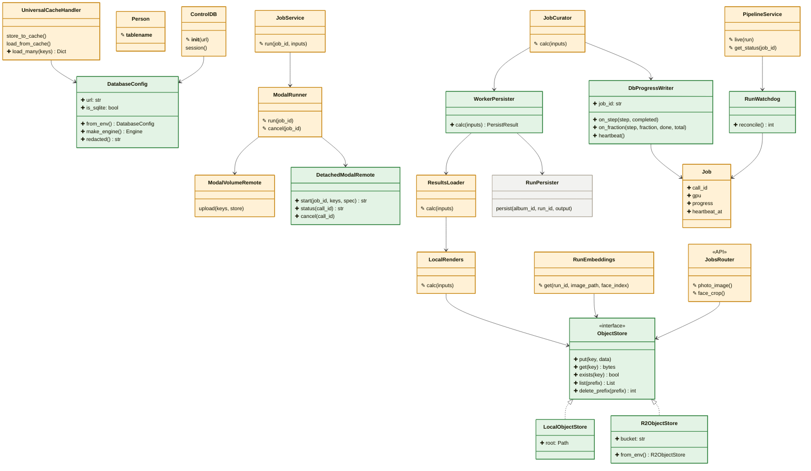

# spec-117 — One cloud database: everything on Neon, files on R2, L4 runs survive a dropped PC

**Status:** Code Review — accepted, no High open (2026-11-15; [REVIEW](REVIEW.html)) · **Created:** 2026-11-06 · **Roadmap:** Stage C, next, before Gate 1 · **Resolves:** SIGHTING-145, SIGHTING-143 · **Supersedes:** [spec-112](../112-live-db-storage-runner/spec.html) Phase B

Colour = type of change: NEW CHANGED REMOVED. Progress = ● done · ◐ partly done · ○ planned. In the class diagram: ✚ new member · ✎ changed · ✖ removed · unmarked = unchanged.

## 1. Objective

Every Albumify table (albums, runs, results, people, metrics, feature cache, jobs) moves into one Neon Postgres
database; display images, face crops and embeddings move to R2. The L4 worker writes status, progress and results
there itself, so the app only reads the database and a dropped PC no longer stops or loses a run.

## 2. Requirements

| # | Status | Requirement | How we know it works |
|---|---|---|---|
| R1 | ◐ | One `DATABASE_URL`, loaded from `.env` at start, puts every Albumify table on Neon: the API's tables, the job tables and the feature cache. Unset, everything stays on local SQLite as today | ● `tests/storage/test_database_config.py`; ○ real: API starts on Neon, all tables listed |
| R2 | ◐ | The two `people` tables no longer clash: the job table becomes `job_people`, existing rows kept | ● `tests/control/test_jobs.py::test_job_people_table`; ○ real: both tables on Neon |
| R3 | ◐ | The API, control and serving suites pass on Postgres as well as SQLite | ● `tests/storage/test_neon_parity.py` runs `tests/api`, `tests/control`, `tests/serving` on a throwaway Neon branch (`-m needs_neon`): 0 failed |
| R4 | ● | **Migration:** existing albums, runs, results, people, metrics, profiles, feature cache and jobs are copied to Neon. Row counts match per table; the script refuses a non-empty target; the SQLite files stay as the backup | ● `tests/scripts/test_migrate_to_neon.py` (6, on SQLite and on Neon); ● real 2026-11-13: 17 tables, counts verified ([updates.md](updates.html)) |
| R5 | ● | **Status and progress from the database only:** the worker writes step, step fraction, photo n of N and a heartbeat at least every 5 s; the app shows "triage_content 43% (307/715)" for local and L4 runs alike. `progress.json` is retired | ● `tests/serving/test_db_progress.py`; ● real L4 run 2026-11-14: step, in-step fraction and photo n/N moved in the job row, heartbeat ≤ 7 s old |
| R6 | ● | **The worker writes the results:** rows go to Neon with original photo paths (the manifest carries them), from the L4 and from this PC. Nothing is copied back to the PC | ● `tests/serving/test_worker_persister.py`; ● real L4 run `f7d8ba85`: rows in Neon with original paths, 0 staged paths, this PC's job folder holds only the manifest |
| R7 | ◐ | Display images, face crops and embeddings live in the private R2 bucket under `jobs/<id>/`. The API serves only a job's own keys; another job's key or a made-up key returns 404 | ● `tests/storage/test_object_store.py` (moto: a fake S3 for tests); ● `tests/api/test_jobs_router.py::test_other_jobs_photo_is_404` on R2; ○ real: People tab crops load |
| R8 | ● | **Detached L4 runs:** started on the deployed Modal app; the call id is stored on the job. Cutting the PC's network for 2 minutes, or restarting the API, neither stops nor loses the run | ● real: run `54b46cd0` went on through an API restart; `f7d8ba85` finished with the API and UI stopped (no admin rights to cut the Wi-Fi itself); results in Albums |
| R9 | ◐ | **Failure end states:** a crashed, timed-out or vanished worker turns the job `failed` with the reason within 2 minutes of the heartbeat stopping; Cancel works by call id; a queued run reads "Waiting for a GPU", not "Running" | ● `tests/serving/test_run_watchdog.py`; ○ real: cancel of a queued L4 run |
| R10 | ● | **GPU fallback:** Modal tries L4, then A10G; the run records the GPU it got; the spend cap is checked against the dearest GPU in the list | ● `tests/serving/test_modal_gpu_choice.py`; ● real: every run recorded `NVIDIA A10` (Modal fell back from the L4) |
| R11 | ○ | Local and L4 runs look the same in Albums, Results, People & Faces and Explore. Pages served from this PC over Neon open in under 2 s | ○ `tests/test_albums_table_e2e.py`, `tests/test_configure_run_on_e2e.py` on Neon; ○ real: page timings for Slovakia26 |
| R12 | ● | **One feature cache for both machines:** an L4 run after a local run of the same photos recomputes no cached step. Cache reads are one query per step, not per photo | ● `tests/pipeline/test_cache_handler_batch.py`; ● real: L4 after L4, cached steps 11-99 ms; local after L4, 2.7-4.3 s each (fresh: minutes). Rows cached before spec-117 by full path stay PC-only |
| R13 | ◐ | **Secrets:** only in `.env` (gitignored) and the Modal secret `albumify-cloud`; never in logs, API responses, run records or the worker image; logged URLs are redacted | ● `tests/architecture/test_no_secrets_leak.py`; ○ real: `git grep`, log and run-record scan after the L4 run |
| R14 | ◐ | **Cost and size:** after Slovakia26 and Budapest, Neon is under 1 GB and R2 under 10 GB (both free plans). A deleted job's R2 objects are deleted with it | ● `tests/storage/test_object_store.py::test_delete_prefix`; ○ real: sizes in updates.md |
| R15 | ◐ | **No cloud, no change:** without `DATABASE_URL` and `R2_*` the app, the tests and CI run on SQLite and a local folder. The V2 Budapest gate stays green | ● `tests/storage/test_database_config.py::test_unset_is_sqlite`; ○ real: full suite with no `.env`, Budapest gate (`tests/face_clustering/e2e_budapest/`) 11 passed |

**Definition of done:** every row ● with evidence in [updates.md](updates.html); the full suite green on SQLite and the `needs_neon` set green on Neon; Slovakia26 run on the L4 and on this PC against Neon + R2; `/code-review` gives a REVIEW.md with no High findings; `scripts/prd_lint.py` passes.

## 3. Plan

Thick border ● = done; dashed ○ = planned. Each step ends on the check that closes it.

```mermaid
flowchart TD
  W1["<b>● W1 One database setting</b><br/>load .env · one engine factory for API, jobs, cache ·<br/>psycopg + boto3 · job_people rename<br/><i>storage/database.py (new), api/database/session.py,<br/>control/db.py, control/models.py, api/main.py, requirements.txt</i>"]
  C1{{"○ check R1 R2 R15"}}
  W2["<b>● W2 Postgres parity</b><br/>run the suites on a Neon branch · portable column migrations<br/><i>api/database/session.py, control/db.py, tests (needs_neon)</i>"]
  C2{{"○ check R3"}}
  W3["<b>● W3 Files on R2</b><br/>object store (local folder or R2) · renders, crops, embeddings ·<br/>routes serve through the store<br/><i>storage/object_store.py (new), local_renders.py, loader.py,<br/>run_embeddings.py, routers/jobs.py, job_store.py</i>"]
  C3{{"○ check R7 R14"}}
  W4["<b>● W4 Worker writes the database</b><br/>progress + heartbeat rows · results rows with original paths<br/><i>db_progress.py (new), worker_persister.py (new), curate_job.py,<br/>job_service.py, pipeline_service.py</i>"]
  C4{{"○ check R5 R6"}}
  W5["<b>◐ W5 Detached L4 runs</b><br/>deployed app · spawn by name · call id · watchdog · GPU list<br/><i>detached_modal.py (new), run_watchdog.py (new), runners.py,<br/>modal_app.py, configs/serving.yaml</i>"]
  C5{{"○ check R8 R9 R10"}}
  W6["<b>● W6 One feature cache</b><br/>cache on Neon · batch read per step<br/><i>pipeline/cache_handler.py, curate_job.py, modal_app.py</i>"]
  C6{{"○ check R12"}}
  W7["<b>● W7 Move the data</b><br/>copy SQLite to Neon, verify counts<br/><i>scripts/migrate_to_neon.py (new)</i>"]
  C7{{"○ check R4"}}
  W8["<b>○ W8 Prove on real data</b><br/>owner OK before each L4 run<br/>Slovakia26 local + L4 · network cut · secret scan · sizes"]
  C8{{"○ check R8 R11 R13 R14<br/>full suite · Budapest gate · /code-review"}}
  W1 --> C1 --> W2 --> C2 --> W3 --> C3 --> W4 --> C4 --> W5 --> C5 --> W6 --> C6 --> W7 --> C7 --> W8 --> C8
  classDef done fill:#FFFFFF,stroke:#1B1714,stroke-width:3px,color:#1B1714
  classDef todo fill:#FFFFFF,stroke:#A89F92,stroke-width:1px,stroke-dasharray:5 4,color:#4A4239
  classDef check fill:#F7F4EE,stroke:#A89F92,color:#1B1714
  class W1,W2,W3,W4,W6,W7 done
  class W5,W8 todo
  class C1,C2,C3,C4,C5,C6,C7,C8 check
```

## 4. Class diagram

Green = new class, amber = changed class, grey = existing, unchanged. ✚ new member · ✎ changed · ✖ removed · unmarked = unchanged.

## 5. New files

| File | Class | Responsibility | Methods | Attributes | Status |
|---|---|---|---|---|---|
| `sim_bench/storage/database.py` | `DatabaseConfig` | The one database setting: reads `.env`, builds the engine for SQLite or Postgres (pooled, pre-ping), redacts the URL for logs | `from_env`, `make_engine`, `redacted` | `url`, `is_sqlite` | ● |
| `sim_bench/storage/object_store.py` | `ObjectStore`, `LocalObjectStore`, `R2ObjectStore` | Files by key: a local folder when `R2_*` is unset, the private R2 bucket otherwise | `put`, `get`, `exists`, `list`, `delete_prefix`, `from_env` | `root`, `bucket` | ● |
| `sim_bench/serving/db_progress.py` | `DbProgressWriter` | Writes step, fraction, n of N and a heartbeat to the job row, at most every 2 s; replaces `progress.json` | `on_step`, `on_fraction`, `heartbeat` | `job_id`, `db` | ● |
| `sim_bench/serving/worker_persister.py` | `WorkerPersister` | In the worker, after the pipeline: maps staged paths to originals from the manifest, writes job rows and Albumify result rows in one transaction | `calc` | `db`, `store` | ● |
| `sim_bench/serving/detached_modal.py` | `DetachedModalRemote` | Starts a run on the deployed Modal app by name and returns the call id; status and cancel by call id | `start`, `status`, `cancel` | `app_name`, `gpu` | ● |
| `sim_bench/serving/run_watchdog.py` | `RunWatchdog` | Turns a job `failed` when its heartbeat stops or its Modal call ended without a result | `reconcile` | `db`, `remote`, `grace_s` | ● |
| `scripts/migrate_to_neon.py` | `NeonMigrator` | Copies the Albumify tables from `sim_bench.db` and `control.db` to Neon; refuses a non-empty target; verifies counts | `plan`, `copy`, `verify` | `source_urls`, `target_url` | ● |

## 6. Modified files

| File | Class / function | Today | After this spec | Req | Status |
|---|---|---|---|---|---|
| `sim_bench/api/database/session.py` | `get_database_url`, `init_db`, `_migrate_new_columns` | Always `sqlite:///` from `SIM_BENCH_DB`; SQLite-only column adds | `DatabaseConfig` from `DATABASE_URL`, SQLite when unset; column adds work on both | R1 R3 R15 | ● |
| `sim_bench/api/main.py` | startup | `init_db()` only | Loads `.env` first; starts `RunWatchdog` | R1 R9 | ● |
| `sim_bench/control/db.py` | `ControlDB` | Own `DATABASE_URL`, default `control.db` | Same engine factory as the API, so one database | R1 | ● |
| `sim_bench/control/models.py` | `Person`, `Job` | Table `people`; no call id or progress | Table `job_people`; `Job` gains `call_id`, `gpu`, `progress`, `heartbeat_at` | R2 R5 R8 | ● |
| `sim_bench/control/local_renders.py` | `LocalRenders` | Writes `display/` and `faces/` under the jobs folder | Writes to the object store (worker on the L4, API on this PC) | R7 | ● |
| `sim_bench/control/loader.py` | `ResultsLoader` | Reads `album.json`, `bundle.json` from the job folder; keys from a folder listing | Runs in the worker; keys from the object store | R6 R7 | ● |
| `sim_bench/serving/curate_job.py` | `JobCurator`, `run_pipeline`, `feature_cache_path` | Writes `progress.json`; cache is a SQLite file | `DbProgressWriter`; cache through `DATABASE_URL`; `WorkerPersister` at the end | R5 R6 R12 | ● |
| `sim_bench/serving/runners.py` | `ModalRunner`, `ModalVolumeRemote` | `run_job` holds a live link and waits; `download_results` copies back | Starts detached, then follows the job row; no copy-back (`ModalVolumeRemote.run_job` and `download_results` removed, so they left the class diagram) | R6 R8 | ● |
| `sim_bench/serving/modal_app.py` | apps, `_curate_job`, `GPU_TYPE` | Temporary app; one GPU type; cache file copied in and out; no secret | Deployed app; `gpu` list; secret `albumify-cloud`; no cache Volume | R8 R10 R12 R13 | ● |
| `sim_bench/serving/job_service.py` | `JobService.run` | Stages, runs, loads results, writes rows | Stages and starts; rows come from the worker; deleting a job deletes its R2 objects | R6 R14 | ● |
| `sim_bench/serving/job_store.py` | `write_progress`, `read_progress`, `objects`, `read_object`, manifest | `progress.json` and display files on disk | `progress.json` removed; `objects` (the object store) + `read_object`; manifest carries originals' pixel sizes; inputs and run spec stay local (`write_displays` kept for the debug-only worker renders) | R5 R6 R7 | ● |
| `sim_bench/api/services/pipeline_service.py` | `PipelineService.live`, `get_status` | Job status + local `progress.json` | Job row only: stage, step, fraction, heartbeat; same view for local and L4 runs | R5 R9 R11 | ● |
| `sim_bench/api/services/run_embeddings.py` | `RunEmbeddings` | Reads `results/*.npy` from the jobs folder | Reads them from the object store | R7 | ● |
| `sim_bench/api/routers/jobs.py` | `photo_image`, `face_crop` | `FileResponse` from the jobs folder | Streams the job's own key from the object store | R7 | ● |
| `sim_bench/pipeline/cache_handler.py` | `UniversalCacheHandler` | One query per photo | `load_many`: one query per step | R12 | ● |
| `configs/serving.yaml` | runner settings | One GPU type | `gpu: [L4, A10G]` | R10 | ● |
| `requirements.txt` | dependencies | No Postgres driver, no S3 client | `psycopg[binary]`, `boto3`; `moto` for tests | R1 R7 | ● |
| `sim_bench/control/jobs.py` | `JobRepo` | Status transitions only; `reap_orphans` fails any live job whose process is gone | `set_progress` (progress, heartbeat, call id, gpu); `reap_orphans` skips detached jobs (they have a call id) | R5 R8 | ● |
| `sim_bench/serving/path_map.py` | `PathMap.from_job` | Opens each original for its pixel scale | Uses the manifest's sizes, so the L4 worker needs no original | R6 | ● |
| `sim_bench/serving/serving_config.py` | `ServingConfig` | One L4 price | `gpu` list, `gpu_dollars_per_hour`, `dearest_dollars_per_hour` | R10 | ● |
| `sim_bench/pipeline/base.py` | cached-step template | One `store_to_cache` commit per photo | One `store_many` batch per step | R12 | ● |
| `sim_bench/api/schemas/pipeline.py`, `app/streamlit/{api_client,models}.py`, `app/streamlit/pages/configure.py`, `app/streamlit/components/pipeline_runner.py` | `PipelineStatus`, `PipelineProgress`, run page | Step list for this PC only | `step_fraction`, photo n of N, `gpu`; "43% (307/715)" and the step list on both machines; "Waiting for a GPU" | R5 R9 R11 | ● |
| `docs/architecture/classes.html`, `docs/architecture/db_schemas.html` | classes, `jobs` columns | spec-116 state | New classes; `jobs.progress/heartbeat_at/call_id/gpu`; `job_people` | R2 R5 | ● |
| `docs/architecture/data_flow.html` | data flow | SQLite files + copy-back | Neon + R2 + detached worker | R6 | ● |

## Decisions, risks, non-goals

- **New spec, not spec-112 Phase B:** the scope grew from "switch the URL" to every Albumify table plus a worker that writes the database. spec-112 Phase B now points here.
- **Supersedes spec-112 AC7** ("the worker holds no DB credentials"): owner decision 2026-11-06, the worker writes status, progress and results itself. The credentials sit in the Modal secret only.
- **Risk, latency:** Neon is in US East, the PC may be far from it. Pages make many small queries; R11 sets a 2 s bar and W8 measures it. Fallback: batch the page queries.
- **Risk, cache keys:** one cache for both machines needs the same key on both; staged photos are keyed by content (`<sha16>/<stem>`), checked by R12.
- **Non-goals:** the separate face clustering app and its stores (`~/.sim_bench/runs/`, `face_clustering.db`, `action_log`, training tables) stay local SQLite; `image_cache/` (3.7 GB of regenerable copies) and the staged 768 px inputs stay on disk and the Modal inputs Volume; merging the job tables with the Albumify result tables.
- [NEEDS CLARIFICATION] Should the separate face clustering app move too? This spec says no: it is a research tool, and the owner said "everything" about Albumify.
