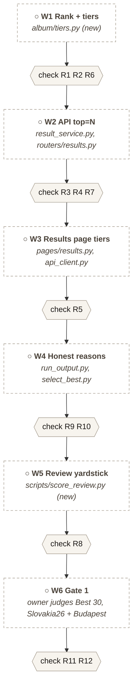
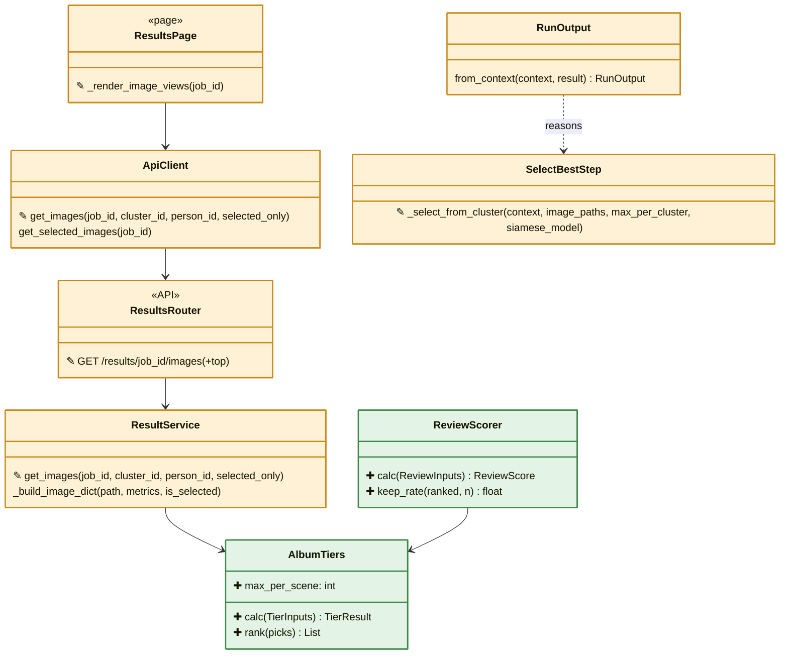

# spec-118 — Album tiers (Best 10 / Best 30 / All) and Gate 1 on Best 30

**Status:** Draft · **Created:** 2026-11-13 · **Roadmap:** Stage A/C, Gate 1 · **Resolves:** SIGHTING-149, SIGHTING-150 · **Evidence:** [2026-11-13 picks review](../../reports/2026-11-13_slovakia26_picks_review/report.html)

Colour = type of change: NEW CHANGED REMOVED. Progress = ● done · ◐ partly done · ○ planned. In the class diagram: ✚ new member · ✎ changed · ✖ removed · unmarked = unchanged.

## 1. Objective

Show an album as Best 10, Best 30 or all picks, ranked by score and spread over scenes, and judge Gate 1 on Best 30.
The owner's review of Slovakia26 kept 100% of the top 20 picks and 93% of the top 30, but only 73% of all 302: the tail is weak, the top is not.
Keep that review as a yardstick, so every later quality fix (parked below) is scored without another manual pass.

## 2. Requirements

| # | Status | Requirement | How we know it works |
|---|---|---|---|
| R1 | ○ | Picks are ranked across all scenes by `composite_score`, highest first; ties go to the earlier photo | `tests/album/test_tiers.py::test_ranks_by_score_across_scenes` |
| R2 | ○ | Best N takes at most 2 picks per scene while other scenes still have picks, then fills by score, so N is always reached when there are N picks | `tests/album/test_tiers.py::test_best_n_spreads_over_scenes`; real: Slovakia26 Best 30 spans at least 15 scenes |
| R3 | ○ | `GET /api/v1/results/{job_id}/images?selected_only=true&top=N` returns N picks in rank order; without `top` the response is unchanged | `tests/api/test_results_tiers.py::test_top_returns_ranked_picks`, `::test_without_top_nothing_changes` |
| R4 | ○ | `top` outside 1-1000 is a 422; the route serves only that job's own result, as today (no new data exposed) | `tests/api/test_results_tiers.py::test_top_out_of_range_is_422` |
| R5 | ○ | Results page view selector: Best 10 · Best 30 (default) · All picks · All processed · By cluster; each card shows its rank | Playwright `tests/test_results_tiers_e2e.py::test_best_30_is_default_and_ranked` on the real app |
| R6 | ○ | An album with fewer picks than N shows them all, labelled "all 7 picks" | `tests/album/test_tiers.py::test_fewer_picks_than_n`; Playwright same file |
| R7 | ○ | Runs made before this spec rank without a re-run (from stored `composite_score` + `scene_clusters`) | `tests/api/test_results_tiers.py::test_old_run_ranks`; real: run `52776cc5` opens as Best 30 |
| R8 | ○ | Review yardstick: `scripts/score_review.py` scores any run against `picks_review.json` (keep rate at Best 10 / 30 / all, photos you wanted that it now picks) | `tests/scripts/test_score_review.py`; real: on `52776cc5` it reproduces 10/10, 28/30, 219/299 |
| R9 | ○ | SIGHTING-149: a photo removed by a filter shows that filter's reason, not "Person detected" | `tests/serving/test_run_output.py::test_a_rejection_reason_wins_over_detection` |
| R10 | ○ | SIGHTING-150: `select_best` reasons ("Best in cluster", "Rank N") follow score order | `tests/pipeline/test_select_best_reasons.py::test_rank_follows_score` |
| R11 | ○ | **Gate 1:** the owner judges Best 30 of Slovakia26 (run made on Neon + R2, spec-117 T8.1) and of Budapest in the app; passes at Best 30 ≥ 90% kept and Best 10 all kept; verdict and keep rate go in updates.md | real: owner verdict recorded; `score_review.py` numbers for Slovakia26 |
| R12 | ○ | Nothing else breaks | full suite `pytest tests` green; Budapest gate `tests/face_clustering/e2e_budapest/` 11/11; real: Slovakia26 + Budapest open in the app |

**Definition of done:** every row ● with evidence in [updates.md](updates.html); `/code-review` → REVIEW.md with no high findings; `scripts/prd_lint.py` passes.

## 3. Plan

## 4. Class diagram

## 5. New files

All NEW. Test files are listed per task in [tasks.md](tasks.html).

| File | Class | Responsibility | Methods | Attributes | Status |
|---|---|---|---|---|---|
| `sim_bench/album/tiers.py` | `AlbumTiers`, `TierInputs`, `TierResult` | Rank picks by score across scenes; cut Best N with a per-scene cap | `calc(inputs)`, `rank(picks)` | `max_per_scene=2`; inputs: picks (path, score, scene, time), `top`; result: `ranked`, `n_scenes` | ○ |
| `scripts/score_review.py` | `ReviewScorer`, `ReviewInputs`, `ReviewScore` | Score a run against the owner's `picks_review.json` (matched by file name) | `calc(inputs)`, `keep_rate(ranked, n)` | result: keep rate at 10 / 30 / all, wanted photos now picked, unjudged picks | ○ |

## 6. Modified files

All CHANGED.

| File | Class / function | Today | After this spec | Req | Status |
|---|---|---|---|---|---|
| `sim_bench/api/services/result_service.py` | `ResultService.get_images` | Picks in stored, cluster-by-cluster order | Optional `top`: ranked by `AlbumTiers`, first N | R3 R7 | ○ |
| `sim_bench/api/routers/results.py` | `get_result_images` | `cluster_id`, `person_id`, `selected_only` | + `top` (1-1000) | R3 R4 | ○ |
| `app/streamlit/api_client.py` | `ApiClient.get_images` | No `top` | Passes `top` | R5 | ○ |
| `app/streamlit/pages/results.py` | `_render_image_views` | Selected Only · All Processed · By Cluster | Best 10 · Best 30 (default) · All picks · All processed · By cluster; rank on each card | R5 R6 | ○ |
| `sim_bench/serving/run_output.py` | `build_reason_by_path` | First decision per photo wins (detection), unless `select_best` | A `rejected` decision wins over detection notes; `select_best` still last | R9 | ○ |
| `sim_bench/pipeline/steps/select_best.py` | `SelectBestStep._select_from_cluster` | Rank counted over the unsorted list | Rank counted over the score-sorted list | R10 | ○ |

## Evidence: 2026-11-13 Slovakia26 picks review (run `52776cc5`, K=51)

Owner reviewed 101 of 106 pages in `reports/2026-11-13_slovakia26_picks_review/review.html`; answers in `picks_review.json`.

| Picks ranked by score | Kept | | Drop reasons (80) | Count |
|---|---|---|---|---|
| Best 10 | 10/10 (100%) | | near-duplicate of another pick | 47 |
| Best 20 | 20/20 (100%) | | other / no reason | 18 |
| Best 30 | 28/30 (93%) | | dull / no value | 6 |
| Best 50 | 45/50 (90%) | | eyes closed / not looking | 5 |
| Best 100 | 82/100 (82%) | | framing 4 · stranger 4 · blurry 2 | 10 |
| All | 219/299 (73%) | | | |

- **Wanted but not picked: 29.** 20 of 20 on the one "removed before scenes" page reviewed (sharpness filter, 0.02-0.20; 69 removed photos not yet seen), 9 inside scenes.
- **People:** persons 0-3 right; 4 is a split of 2; 5-7 are strangers (8 found, about 4 real).
- **Scenes** are visual only (DINOv2 + HDBSCAN, no time or place): scene 5 mixes Aug 18 and Aug 29.
- Labels "Best in cluster" / "Rank N" in this run are not score order (SIGHTING-150), so drop reasons are not broken down by them.

## Quality backlog (parked; measured with `score_review.py` when taken up)

| Idea | Evidence | Owner note |
|---|---|---|
| Score that trades quality against similarity to the other picks, instead of a flat 2 per people group | 47 of 80 drops are near-duplicates; `max_images_per_cluster: 2` | "logic we explicitly defined; we have control over it" |
| Filter out uninteresting photos | dull 6 drops; dryer photo (lone page 3) | "need to find a way to remove non-interesting photos" |
| Stronger penalty for bad faces | eyes / not looking 5; kid pulling a face (scene 39) | "penalize more strongly for bad faces" |
| Scenes by time and place too | scene 5 spans 11 days; spec-103 `build_scene_distance` is off by default | "too many clusters, cluster also by time/geo" |
| Sharpness filter off or much lower | 20/20 here and 59/60 on 2026-11-06 were wrong removals | Parked (owner 2026-11-13) |
| Finger in frame | scene 82 note; `score_occlusion` exists (spec-097) | "was it detected?" |
| People: 3 strangers + 1 split | People tab verdicts | — |

## Open decisions / risks / non-goals
- Decided 2026-11-13: Gate 1 bar = Best 30 at least 90% kept and Best 10 all kept (ROADMAP decision 1).
- Decided 2026-11-13: sharpness filter parked with the rest of the backlog.
- Risk: the per-scene cap of 2 is a guess; R2's real check shows whether Best 30 looks varied.
- Non-goals: the Jobs page picks view and `album.json` export stay chronological; no pipeline scoring changes besides R10's labels.
