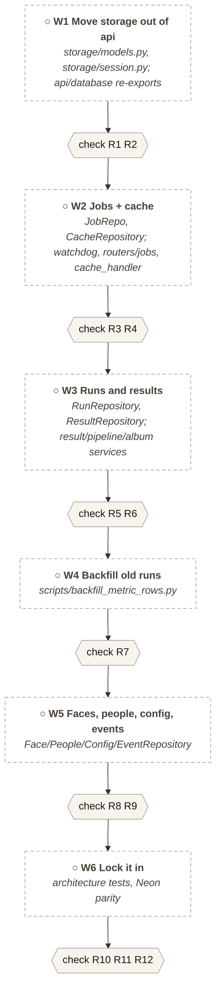

# spec-119 — One repository layer: every database read and write goes through a repository

**Status:** Proposal (not approved; number provisional) · **Created:** 2026-11-14 · **Roadmap:** Stage C, after spec-117 merges · **Continues:** [spec-086](../086-image-repository-over-rundb/spec.md) (slice 1) · **Resolves:** spec-117 review M3

Colour = type of change: NEW CHANGED REMOVED. Progress = ● done · ◐ partly done · ○ planned. In the class diagram: ✚ new member · ✎ changed · ✖ removed · unmarked = unchanged.

## 1. Objective

Every database read and write goes through a repository (one small class per kind of data, the only code that writes queries).
Services, routers, the watchdog and the GPU worker call repositories; `serving/` stops importing from `api/` (review M3).
Results are read from the normalized metric tables instead of the JSON blobs; API responses do not change.

## 2. Requirements

| # | Status | Requirement | How we know it works |
|---|---|---|---|
| R1 | ○ | Engine, session and ORM models move from `api/database/` to `storage/`; `api/database/` re-exports them for one release so nothing breaks | `tests/architecture/test_layers.py::test_serving_does_not_import_api`; full suite green |
| R2 | ○ | `serving/`, `control/` and `pipeline/` import nothing from `sim_bench.api` | `tests/architecture/test_layers.py` (import-graph check over the package) |
| R3 | ○ | `JobRepo` also owns every job *read*: live jobs, recent jobs, events, photos and faces of a job; the watchdog, `routers/jobs.py` and `control/` use it | `tests/control/test_jobs.py::test_repo_reads`; grep check R10 |
| R4 | ○ | `CacheRepository` owns `universal_cache`: batch get per step, put with a duplicate-safe upsert (fixes review M2), delete for `routers/results.py` | `tests/storage/test_cache_repository.py::test_concurrent_put_same_key`; `tests/pipeline/test_cache_handler_batch.py` unchanged and green |
| R5 | ○ | `RunRepository` owns albums, runs and run records; `result_service`, `pipeline_service`, `album_service` use it | `tests/storage/test_run_repository.py`; `tests/api` green |
| R6 | ○ | `ResultRepository` reads picks, scene clusters and per-image metrics from the normalized tables; the API response shapes do not change | `tests/storage/test_result_repository.py::test_same_payload_as_blob` on Budapest and Slovakia26 runs |
| R7 | ○ | Old runs that have only JSON blobs are backfilled into the normalized tables by a one-off script (row counts printed, refuses a run already filled); the blobs stay as the backup | `tests/scripts/test_backfill_metric_rows.py`; real: every run in Albums opens after the backfill |
| R8 | ○ | `FaceRepository` and `PeopleRepository` own faces, overrides and people; `face_service`, `people_service` use them (`ImageRepository` folds into `ResultRepository`) | `tests/storage/test_face_repository.py`; `tests/api/test_people*.py` green |
| R9 | ○ | `ConfigRepository` and `EventRepository` own profiles and user events | `tests/storage/test_config_repository.py`, `test_event_repository.py` |
| R10 | ○ | No `select(`, `.query(` or `session.execute` outside `storage/repositories/` and `control/jobs.py` (migrations and scripts excepted, listed in the test) | `tests/architecture/test_no_queries_outside_repos.py` |
| R11 | ○ | Repositories take a session from the caller, so one request = one transaction; every repository has a test on SQLite and the parity set runs them on Neon | `tests/storage/test_neon_parity.py` (`-m needs_neon`): 0 failed |
| R12 | ○ | Nothing else changes: pages, API responses, picks | full suite green; Budapest gate 11/11; real: Slovakia26 and Budapest open in Albums, Results, People with the same picks |

**Definition of done:** every row ● with evidence in updates.md; `/code-review` → REVIEW.md with no high findings; `scripts/prd_lint.py` passes.

## 3. Plan

Each step merges on its own (strangler fig: the new path replaces the old one area by area, never all at once).

## 4. Class diagram

```mermaid
classDiagram
  direction TB
  class ResultService {
    ✎ get_images(job_id, cluster_id, person_id, selected_only)
    ✎ get_clusters(job_id)
    ✎ get_metrics(job_id)
  }
  class PeopleService {
    ✎ list_people(album_id, run_id)
    ✎ get_person_images(album_id, person_id)
  }
  class FaceService {
    ✎ get_all_faces()
    ✎ apply_batch_changes()
  }
  class RunWatchdog {
    ✎ reconcile(job_ids) int
  }
  class WorkerPersister {
    ✎ calc(inputs) PersistResult
  }
  class UniversalCacheHandler {
    ✎ store_many(items, metadata) int
    ✎ load_many(keys) Dict
  }
  class JobRepo {
    ✚ live() List
    ✚ photos(job_id) List
    ✚ faces(job_id) List
    get(job_id)
    list(limit)
    events(job_id)
  }
  class CacheRepository {
    ✚ get_many(keys) Dict
    ✚ put_many(items) int
    ✚ delete(key)
  }
  class RunRepository {
    ✚ run(run_id)
    ✚ runs(album_id) List
    ✚ save_run(run)
  }
  class ResultRepository {
    ✚ picks(run_id) List
    ✚ scenes(run_id) Dict
    ✚ image_metrics(run_id, paths) List
    ✚ images_for_person(run_id, person_id) List
  }
  class FaceRepository {
    ✚ faces(run_id) List
    ✚ overrides(run_id) List
    ✚ save_override(override)
  }
  class PeopleRepository {
    ✚ people(album_id, run_id) List
    ✚ rename(person_id, name)
    ✚ merge(person_ids)
  }
  class ImageRepository {
    ✖ get_images_for_person(run_id, person_id)
  }
  ResultService --> ResultRepository
  ResultService --> RunRepository
  PeopleService --> PeopleRepository
  PeopleService --> ResultRepository
  FaceService --> FaceRepository
  RunWatchdog --> JobRepo
  WorkerPersister --> RunRepository
  UniversalCacheHandler --> CacheRepository
  style CacheRepository fill:#E3F3E5,stroke:#3E8A4B,stroke-width:2px
  style RunRepository fill:#E3F3E5,stroke:#3E8A4B,stroke-width:2px
  style ResultRepository fill:#E3F3E5,stroke:#3E8A4B,stroke-width:2px
  style FaceRepository fill:#E3F3E5,stroke:#3E8A4B,stroke-width:2px
  style PeopleRepository fill:#E3F3E5,stroke:#3E8A4B,stroke-width:2px
  style JobRepo fill:#FFF1D6,stroke:#C98A1B,stroke-width:2px
  style ResultService fill:#FFF1D6,stroke:#C98A1B,stroke-width:2px
  style PeopleService fill:#FFF1D6,stroke:#C98A1B,stroke-width:2px
  style FaceService fill:#FFF1D6,stroke:#C98A1B,stroke-width:2px
  style RunWatchdog fill:#FFF1D6,stroke:#C98A1B,stroke-width:2px
  style WorkerPersister fill:#FFF1D6,stroke:#C98A1B,stroke-width:2px
  style UniversalCacheHandler fill:#FFF1D6,stroke:#C98A1B,stroke-width:2px
  style ImageRepository fill:#FBE4E2,stroke:#A8322D,stroke-width:2px
```

Config, events, albums and the session move are in the tables below; left out of the diagram to keep it readable.

## 5. New files

All NEW.

| File | Class | Responsibility | Methods | Attributes | Status |
|---|---|---|---|---|---|
| `sim_bench/storage/models.py` | ORM models | All tables, moved from `api/database/models.py` and `control/models.py` | — | — | ○ |
| `sim_bench/storage/session.py` | — | Engine and session factory, moved from `api/database/session.py` | `get_session`, `get_session_direct` | — | ○ |
| `sim_bench/storage/repositories/cache.py` | `CacheRepository` | Feature cache; duplicate-safe write (review M2) | `get_many`, `put_many`, `delete` | `_session` | ○ |
| `sim_bench/storage/repositories/runs.py` | `RunRepository` | Albums, runs, run records | `run`, `runs`, `save_run` | `_session` | ○ |
| `sim_bench/storage/repositories/results.py` | `ResultRepository` | Picks, scenes, image metrics from the normalized tables | `picks`, `scenes`, `image_metrics`, `images_for_person` | `_session` | ○ |
| `sim_bench/storage/repositories/faces.py` | `FaceRepository`, `PeopleRepository` | Faces, overrides, people | see diagram | `_session` | ○ |
| `sim_bench/storage/repositories/config.py` | `ConfigRepository`, `EventRepository` | Profiles, user events | `get`, `save`, `log`, `recent` | `_session` | ○ |
| `scripts/backfill_metric_rows.py` | — | Fill the normalized tables for old blob-only runs | `main` | — | ○ |
| `tests/architecture/test_layers.py` | — | `serving`/`control`/`pipeline` import nothing from `api` | — | — | ○ |
| `tests/architecture/test_no_queries_outside_repos.py` | — | No query code outside the repositories | — | — | ○ |

## 6. Modified files

All CHANGED.

| File | Class / function | Today | After this spec | Req | Status |
|---|---|---|---|---|---|
| `sim_bench/api/database/models.py` | ORM models | Defines the API tables | Re-exports `storage/models.py` for one release | R1 | ○ |
| `sim_bench/api/database/session.py` | `get_session` | Defines engine and session | Re-exports `storage/session.py` for one release | R1 | ○ |
| `sim_bench/control/jobs.py` | `JobRepo` | All job writes; some reads | + `live`, `photos`, `faces`; all job reads | R3 | ○ |
| `sim_bench/serving/run_watchdog.py` | `RunWatchdog.reconcile` | `select(Job)` itself | `JobRepo.live()` | R3 R10 | ○ |
| `sim_bench/api/routers/jobs.py` | `list_photos` | Queries photos and faces | `JobRepo.photos`, `JobRepo.faces` | R3 R10 | ○ |
| `sim_bench/pipeline/cache_handler.py` | `UniversalCacheHandler` | Imports `api.database.models`; plain insert | `CacheRepository` | R2 R4 | ○ |
| `sim_bench/api/routers/results.py` | `get_face_embedding` | Queries `UniversalCache` | `CacheRepository` | R4 R10 | ○ |
| `sim_bench/api/services/result_service.py` | `ResultService` | Reads JSON blob columns | `RunRepository`, `ResultRepository` | R5 R6 R12 | ○ |
| `sim_bench/api/services/pipeline_service.py` | `PipelineService` | Queries runs | `RunRepository` | R5 | ○ |
| `sim_bench/api/services/album_service.py` | `AlbumService` | Queries albums | `RunRepository` | R5 | ○ |
| `sim_bench/serving/worker_persister.py` | `WorkerPersister`, `write_run_rows` | Imports `api.database` and `api.services` | Imports `storage` | R2 R5 | ○ |
| `sim_bench/serving/runners.py` | worker entry | Imports `api.database.session` | Imports `storage.session` | R2 | ○ |
| `sim_bench/serving/curate_job.py` | cache setup | Imports `api.database` | Imports `storage` | R2 | ○ |
| `sim_bench/serving/run_output.py` | `RunOutput` | Imports `api.schemas`, `api.services.people_service` | Shared shapes move out of `api` | R2 | ○ |
| `sim_bench/api/services/face_service.py` | `FaceService` | 18 query spots | `FaceRepository` | R8 R10 | ○ |
| `sim_bench/api/services/people_service.py` | `PeopleService` | Queries people + `ImageRepository` | `PeopleRepository`, `ResultRepository` | R8 | ○ |
| `sim_bench/api/repositories/image_repository.py` | `ImageRepository` | One read for People | Removed; folded into `ResultRepository` | R8 | ○ |
| `sim_bench/api/services/config_service.py` | `ConfigService` | Queries profiles | `ConfigRepository` | R9 | ○ |
| `sim_bench/api/services/event_service.py` | `EventService` | Queries events | `EventRepository` | R9 | ○ |
| `sim_bench/control/compare.py` | `JobComparer` | Queries directly | Repositories | R10 | ○ |
| `sim_bench/control/album_builder.py` | `AlbumBuilder` | Queries directly | Repositories | R10 | ○ |
| `tests/storage/test_neon_parity.py` | parity set | api/control/serving | + repository tests | R11 | ○ |

## Evidence: where we are

Measured 2026-11-14 on `spec/117-neon-r2` at 9cd0e67.

| Area | Today |
|---|---|
| Repositories | `ImageRepository` (spec-086, used only by `people_service`); `JobRepo` (all job writes; the watchdog and `routers/jobs.py` read around it) |
| Direct queries in services | `face_service` 18 · `result_service` 9 · `pipeline_service` 9 · `config_service` 6 · `people_service` 5 · `event_service` 5 · `album_service` 2 |
| Direct queries in routers | `routers/jobs.py` 3 (photos, faces) · `routers/results.py` 2 (`UniversalCache`) |
| Outside the API | `run_watchdog` reads `jobs` itself; `control/compare.py`, `album_builder.py` query directly; `cache_handler` imports `api.database.models` |
| Layering | `serving/` imports `api.database.session`, `api.database.models`, `api.services.run_persister`, `api.services.people_service` (review M3) |
| Data | `image_metric_rows` / `face_metric_rows` are written by `RunPersister`, but most reads still use the `PipelineResult` JSON columns (`scene_clusters`, `selected_images`, `image_metrics`) |

**Notes**
- Why now: the Neon move showed how many files hold queries; every Neon fix touched several. Each later schema change costs that again.
- Rough size: W1–W2 about a day; W3–W4 the biggest (results payloads must match exactly); W5–W6 about a day.
- Open question for the owner: drop the JSON blob columns after W4, or keep them for a release as a backup?
- Not in scope: a new database library, async access, any change to API responses.
