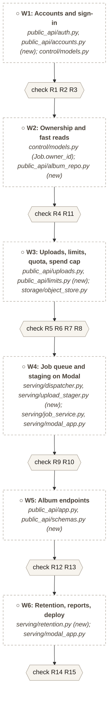

# spec-120 — Accounts and a public API: signed-in users upload a trip and get their album

**Status:** Draft · **Created:** 2026-11-22 · **Roadmap:** Stage C, next (productization plan steps 3-4) · **Plan:** [productization plan](../../docs/project/productization_plan_2026-11-22.html) · **Continues:** [spec-106](../106-albumify-web-showcase/spec.html) (public service), [spec-119](../119-repository-layer/spec.md) (repository slice)

Colour = type of change: NEW CHANGED REMOVED. Progress = ● done · ◐ partly done · ○ planned. In the class diagram: ✚ new member · ✎ changed · ✖ removed · unmarked = unchanged.

## 1. Objective

A signed-in user (invite only at launch) uploads up to 1,000 trip photos, the GPU curates them, and the album stays
in their account until they delete it. A new small public API serves the coming Next.js website; today's FastAPI
stays frozen for the owner's Streamlit app. Costs are capped per account and in total.

## 2. Requirements

| # | Status | Requirement | How we know it works |
|---|---|---|---|
| R1 | ○ planned | Every endpoint except `/health` needs a valid sign-in token from the hosted provider (Clerk); a missing, expired or forged token gets 401 | `tests/public_api/test_auth.py` (signed test keys: valid, expired, wrong issuer, tampered) |
| R2 | ○ planned | Only invited emails get an account; anyone else gets 403 "on the waiting list" | `tests/public_api/test_accounts.py::test_uninvited_email_is_waitlisted` |
| R3 | ○ planned | No upload is accepted until the account has recorded face-grouping consent | `tests/public_api/test_accounts.py::test_upload_needs_face_consent` |
| R4 | ○ planned | A user sees, renames and deletes only their own albums; another user's album answers 404 | `tests/public_api/test_isolation.py` (two users, every endpoint), also in the `needs_neon` parity run |
| R5 | ○ planned | Uploads go straight to R2 with signed URLs; limits are checked before any compute: ≤ 1,000 photos, ≤ 25 MB each, ≤ 6 GB total, JPEG/HEIC/PNG/WebP | `tests/public_api/test_uploads.py`; real R2: signed PUT accepted, oversize and wrong type refused |
| R6 | ○ planned | Creating an upload returns the expected wait (upload + processing minutes) and where it runs; ≥ 300 photos run on the GPU | `tests/public_api/test_uploads.py::test_estimate_and_runner_by_size` |
| R7 | ○ planned | Quota per account per calendar month: 3 albums and 3,000 photos; over it gets 429 with the reset date | `tests/public_api/test_limits.py::test_monthly_quota` |
| R8 | ○ planned | Global spend cap $50 a month: a job that would pass it waits or is refused; an alert is logged at 80 % | `tests/public_api/test_limits.py::test_spend_cap_and_alert` |
| R9 | ○ planned | Jobs wait in the database and a dispatcher starts them in order, at most N at once; restarting the API loses nothing | `tests/serving/test_dispatcher.py` (order, concurrency, restart) |
| R10 | ○ planned | Uploaded originals are turned into 768 px inputs (EXIF kept) by a CPU function before the GPU run | `tests/serving/test_upload_stager.py`; real Modal run of 50 uploaded photos to an album |
| R11 | ○ planned | Album, photos (best 30 by default, `?tier=all`) and people each take at most 2 database queries; under 1 s on Neon for 1,000 photos | `tests/public_api/test_query_counts.py`; real Neon timing on Slovakia26 |
| R12 | ○ planned | The only edit is renaming a person | `tests/public_api/test_people.py::test_rename_person_only` |
| R13 | ○ planned | Deleting an album or the whole account removes every row, face crop and stored file; a listing finds nothing left | `tests/public_api/test_delete.py`; real R2 listing after delete |
| R14 | ○ planned | Original uploads are deleted 7 days after upload; albums and 768 px copies stay until the user deletes them | `tests/serving/test_retention.py` (clock moved 8 days) |
| R15 | ○ planned | A user can report an album photo; the public API runs on Modal at a public URL with a health check, keys only from the Modal secret | `tests/public_api/test_reports.py`; real deploy: `/health` 200, secret scan 0 hits |

**Definition of done:** R1-R15 ● with their checks green on SQLite and Neon, one real invited account takes 200 photos
from upload to album on the deployed API, `/code-review` REVIEW.md has no High open, Budapest gate 11/11.

## 3. Plan

## 4. Class diagram

```mermaid
classDiagram
  direction TB
  class PublicApp {
    <<API>>
    ✚ /v1/me  GET · DELETE
    ✚ /v1/uploads  POST · complete
    ✚ /v1/albums  list · one · photos · people
    ✚ /v1/albums  rename person · DELETE
    ✚ /v1/reports  POST
  }
  class AuthVerifier {
    ✚ verify(token) Claims
  }
  class AccountRepo {
    ✚ get_or_create(claims) Account
    ✚ record_consent(account_id)
    ✚ delete_everything(account_id) int
  }
  class UploadService {
    ✚ create(account_id, files) UploadTicket
    ✚ complete(upload_id) str
  }
  class PublicAlbumRepo {
    ✚ album(account_id, job_id) AlbumView
    ✚ photos(account_id, job_id, tier) List
    ✚ people(account_id, job_id) List
    ✚ rename_person(account_id, job_id, person_id, name)
  }
  class QuotaGuard {
    ✚ check(account_id, n_photos)
  }
  class SpendGuard {
    ✚ allows(dollars) bool
  }
  class JobDispatcher {
    ✚ tick() int
  }
  class UploadStager {
    ✚ calc(StageInputs) StageResult
  }
  class RetentionSweeper {
    ✚ calc(SweepInputs) SweepResult
  }
  class Job {
    status: str
    ✚ owner_id: str
  }
  class R2ObjectStore {
    delete_prefix(prefix) int
    ✚ presigned_put(key, size, content_type) str
    ✚ presigned_get(key) str
  }
  class JobService {
    ✎ create(inputs) str
  }
  class DetachedModalRemote {
    start(job_id, keys, spec, manifest)
  }
  class PipelineService {
    delete_run(run_id) Dict
  }
  PublicApp --> AuthVerifier
  PublicApp --> AccountRepo
  PublicApp --> UploadService
  PublicApp --> PublicAlbumRepo
  UploadService --> QuotaGuard
  UploadService --> SpendGuard
  UploadService --> JobService
  UploadService --> R2ObjectStore
  PublicAlbumRepo --> Job
  AccountRepo --> PipelineService
  JobDispatcher --> SpendGuard
  JobDispatcher --> DetachedModalRemote
  UploadStager --> R2ObjectStore
  RetentionSweeper --> R2ObjectStore
  style PublicApp fill:#E3F3E5,stroke:#3E8A4B,stroke-width:2px
  style AuthVerifier fill:#E3F3E5,stroke:#3E8A4B,stroke-width:2px
  style AccountRepo fill:#E3F3E5,stroke:#3E8A4B,stroke-width:2px
  style UploadService fill:#E3F3E5,stroke:#3E8A4B,stroke-width:2px
  style PublicAlbumRepo fill:#E3F3E5,stroke:#3E8A4B,stroke-width:2px
  style QuotaGuard fill:#E3F3E5,stroke:#3E8A4B,stroke-width:2px
  style SpendGuard fill:#E3F3E5,stroke:#3E8A4B,stroke-width:2px
  style JobDispatcher fill:#E3F3E5,stroke:#3E8A4B,stroke-width:2px
  style UploadStager fill:#E3F3E5,stroke:#3E8A4B,stroke-width:2px
  style RetentionSweeper fill:#E3F3E5,stroke:#3E8A4B,stroke-width:2px
  style Job fill:#FFF1D6,stroke:#C98A1B,stroke-width:2px
  style R2ObjectStore fill:#FFF1D6,stroke:#C98A1B,stroke-width:2px
  style JobService fill:#FFF1D6,stroke:#C98A1B,stroke-width:2px
  style DetachedModalRemote fill:#F2F0EC,stroke:#A89F92
  style PipelineService fill:#F2F0EC,stroke:#A89F92
```

Also new, not drawn: tables `Account`, `Invite`, `ContentReport` (in `control/models.py`), `Limits` (values from
`configs/public.yaml`), `SubmitInputs.owner_id`. Context not drawn: `JobRepo` (queue rows), `InputStore` (staged inputs).

## 5. New files

| File | Class | Responsibility | Methods | Attributes | Status |
|---|---|---|---|---|---|
| `sim_bench/public_api/app.py` | `PublicApp` (FastAPI app) | The ~11 public routes; every route resolves the account first | route functions | `app` | ○ |
| `sim_bench/public_api/auth.py` | `AuthVerifier` | Verify the provider's JWT against its published keys (JWKS); return the claims | `verify(token)` | `issuer`, `jwks_url`, cached keys | ○ |
| `sim_bench/public_api/accounts.py` | `AccountRepo` | Account from claims, invite check, consent, delete everything | `get_or_create`, `record_consent`, `delete_everything` | `db` | ○ |
| `sim_bench/public_api/limits.py` | `Limits`, `QuotaGuard`, `SpendGuard` | Upload limits, monthly quota, monthly spend cap and 80 % alert | `check`, `spent_this_month`, `allows` | values from `configs/public.yaml` | ○ |
| `sim_bench/public_api/uploads.py` | `UploadService` | Signed upload URLs, size/type/count checks, estimate, then a queued job | `create`, `complete` | `store`, `jobs`, `limits` | ○ |
| `sim_bench/public_api/album_repo.py` | `PublicAlbumRepo` | Every public read, owner-filtered, at most 2 queries each (spec-119 slice) | `list`, `album`, `photos`, `people`, `rename_person` | `session` | ○ |
| `sim_bench/public_api/schemas.py` | response models | What the website receives: account, upload ticket, album, photo, person | — | — | ○ |
| `sim_bench/serving/dispatcher.py` | `JobDispatcher` | Start queued jobs in order, at most `max_running`, within the spend cap | `tick()` | `max_running`, `remote` | ○ |
| `sim_bench/serving/upload_stager.py` | `UploadStager` | Originals in R2 → 768 px inputs + manifest, EXIF kept | `calc(StageInputs)` | `store` | ○ |
| `sim_bench/serving/retention.py` | `RetentionSweeper` | Delete originals older than 7 days | `calc(SweepInputs)` | `store`, `clock` | ○ |
| `configs/public.yaml` | — | Limits, quota, spend cap, concurrency, retention days | — | — | ○ |

## 6. Modified files

| File | Class / function | Today | After this spec | Req | Status |
|---|---|---|---|---|---|
| `sim_bench/control/models.py` | `Job`; new `Account`, `Invite`, `ContentReport` | jobs have no owner; no account tables | `Job.owner_id` (indexed); three new tables in the job database | R2 R3 R4 R15 | ○ |
| `sim_bench/storage/object_store.py` | `R2ObjectStore` | put / get / list / delete only | ✚ `presigned_put`, ✚ `presigned_get` (short expiry, size and type fixed in the signature) | R5 R11 | ○ |
| `sim_bench/serving/job_service.py` | `SubmitInputs`, `JobService.create` | jobs come from a folder on this PC | ✚ `owner_id`; a job can start from an upload in R2 (status queued, staged by `UploadStager`) | R4 R10 | ○ |
| `sim_bench/serving/modal_app.py` | Modal functions | `curate_job`, `stage_job` (photos sent from this PC), `purge_inputs` | ✚ `public_api` web endpoint, ✚ `stage_upload`, ✚ `dispatch` every 30 s, ✚ `sweep` daily | R9 R10 R14 R15 | ○ |
| `requirements.txt` | — | no JWT library | ✚ `PyJWT[crypto]` (JWKS verification) | R1 | ○ |

## Decisions, risks, non-goals

- **Owner decisions 2026-11-22:** invite list; 3 albums / 3,000 photos a month; $50 a month cap; 1,000 photos per upload;
  originals 7 days, albums until deleted; face consent + delete everything; US region; private albums; rename only.
- **Clerk** for sign-in: it works natively with Next.js, has a free tier and Google + email-link built in; the API only
  verifies its tokens, so switching to Auth.js later touches `auth.py` alone.
- **Originals go to R2, staged on Modal's CPU.** Resizing in the browser would cut a 4 GB upload to ~0.3 GB but needs a
  HEIC decoder in the browser; left to the website spec as an optimisation.
- **The public API is a second FastAPI app,** not new routes on the old one: none of the old routes are reachable
  from the internet. The old API and Streamlit app keep working, frozen.
- **Risks:** 3-5 GB uploads take 20-40 min at home speeds (the website warns, R6); Neon's free 0.5 GB fills at roughly
  300 albums (today 89 MB for 59 runs), so watch it; Modal web endpoints cold-start in seconds.
- **Not in this spec:** the website (next spec), payments, share links, editing beyond renaming, picking quality
  (after launch), the privacy-policy text (website spec; it states photos are never used for training).
